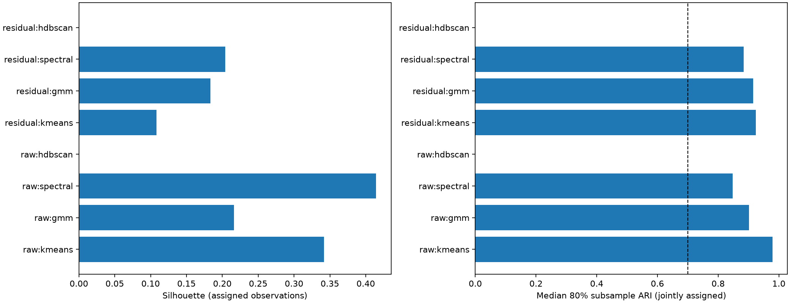
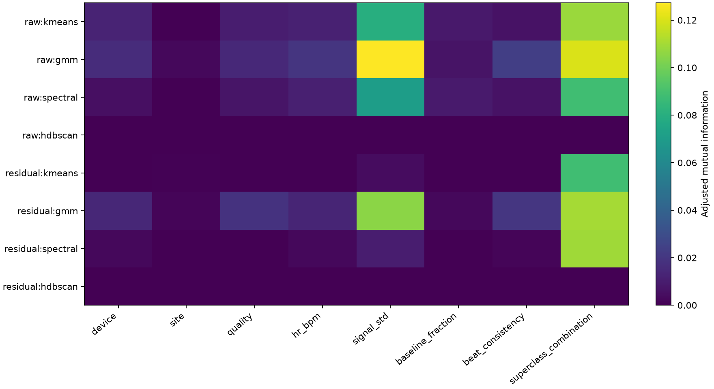

# CLUSTER-01 results: annotation mixtures appear, but the stability gate fails

18 October 2026. The prespecified morphology discovery gate was **not met**. On 1,999 training patients,
nuisance-residualized spectral clustering separated a group enriched for both conduction-disorder and
MI annotations, but one of five subsample refits had adjusted Rand index 0.484, below the required 0.50.
The median was 0.884. These are exploratory clusters of measured morphology and coexisting annotations;
they do not identify disease causes or establish specialist agreement.

The [protocol](cluster-01-physical-morphology.md) was committed locally as `4cdec2e` before any new score,
and implementation was frozen as `bc85c76` before execution. The complete run took 147.21 seconds on CPU
with two numerical threads. The [aggregate receipt](../reports/cluster01_physical_morphology.json) includes
all candidate configurations, source/input hashes, bootstrap results and final artifact verification.
Original local outputs are under `outputs/cluster01_physical_morphology/`; no push or PR was made.

## Cohort and representation

| Identity/cohort check | Executed count |
| --- | ---: |
| NTT-01 folds 1–8 records / patients, identity counts reproduced exactly | 17,418 / 15,023 |
| PR67 training-role records / patients, shared-manifest agreement | 13,938 / 12,078 |
| Deterministic sample, one ECG per patient | 2,000 |
| Excluded for >20% missing morphology features | 1 |
| Analyzed patients | 1,999 |
| Patients with at least two abnormal superclasses | 434 (21.7%) |
| NORM / MI / STTC / CD / HYP annotation counts | 891 / 494 / 474 / 449 / 254 |

All selected patients were independently checked against the coordinator's exact PR67 partition manifest.
Only the training role supplied waveforms or interpreted labels/acquisition metadata. Fold-9/10 patients,
validation and engineering-test reservations were excluded before selection. No Challenge, EchoNext,
MIMIC, SPH or ECGAD data were accessed. Diagnoses were parsed only after unsupervised fitting finished.
No age/sex analysis or label change was performed.

The 53 inputs were existing heuristic measurements from original 500 Hz signals in mV: QRS/QT duration,
RR variation, axis sine/cosine and R/S/ST/T amplitudes in all 12 leads. No new learned encoder was fitted.
There were no caught extraction errors. The excluded ECG lacked enough measured features; all retained
features were finite. The measurements are screening estimates, not validated clinical delineations.
PCA retained 16 components, explaining 91.99% of raw and 90.67% of residualized variation; the 16-component
cap therefore bound both views before reaching the nominal 95% variance target.

The residualized view removed ridge-predicted variation from device, site, rate, overall signal amplitude,
baseline fraction, beat consistency, constant leads and a source quality flag. This may remove meaningful
physiology correlated with those variables. It is a descriptive sensitivity analysis, not causal adjustment.

## Algorithm comparison

Every k-means, diagonal Gaussian mixture and spectral method selected k=2 from k=2/4/8 using only the
frozen silhouette/coverage/size rule. HDBSCAN found no dense clusters at either minimum cluster size,
40 or 80. All non-HDBSCAN configurations displayed below assigned every patient. Stability values are
minimum / median / maximum across five fixed 80% patient subsamples with complete preprocessing refits;
they are not confidence intervals.

| View and method | Cluster sizes | Silhouette | Subsample ARI, min / median / max |
| --- | --- | ---: | --- |
| Raw PCA + k-means | 1,732 / 267 | 0.342 | 0.815 / 0.979 / 0.993 |
| Raw Gaussian mixture | 1,332 / 667 | 0.216 | 0.887 / 0.901 / 0.938 |
| Raw spectral | 1,860 / 139 | 0.415 | 0.411 / 0.848 / 0.913 |
| Raw HDBSCAN | No clusters; 1,999 noise | Undefined | Undefined |
| Residualized PCA + k-means | 1,150 / 849 | 0.108 | 0.153 / 0.924 / 0.926 |
| Residualized Gaussian mixture | 657 / 1,342 | 0.183 | 0.908 / 0.916 / 0.926 |
| Residualized spectral | 1,623 / 376 | 0.204 | 0.484 / 0.884 / 0.916 |
| Residualized HDBSCAN | No clusters; 1,999 noise | Undefined | Undefined |

The unsupervised rule selected residualized spectral as the alternative to PCA+k-means. Its silhouette
gain was 0.096, above the 0.02 threshold, but its worst subsample failed the stability threshold. The
baseline itself also had an unstable refit (ARI 0.153). The mixture's stable refits are a secondary result;
substituting it after seeing the spectral failure would change the prespecified winner rule.

HDBSCAN's raw-versus-residualized ARI is numerically 1 because both partitions consist entirely of noise.
That is not successful clustering or stability. The generic bar plot displays missing HDBSCAN silhouette
and stability at zero; their actual values are undefined, as the table and JSON record.



## Finding mixtures and nuisance associations

Adjusted mutual information (AMI) for selected partitions, including noise where present:

| View and method | Superclass combination | Device | Site | Heart-rate quartile | Amplitude quartile | Quality flag |
| --- | ---: | ---: | ---: | ---: | ---: | ---: |
| Raw k-means | 0.108 | 0.013 | -0.001 | 0.012 | 0.080 | 0.010 |
| Raw mixture | 0.120 | 0.016 | 0.003 | 0.019 | 0.127 | 0.015 |
| Raw spectral | 0.088 | 0.005 | -0.002 | 0.011 | 0.071 | 0.007 |
| Residualized k-means | 0.088 | -0.001 | 0.001 | -0.000 | 0.004 | 0.000 |
| Residualized mixture | 0.110 | 0.014 | 0.002 | 0.013 | 0.105 | 0.019 |
| Residualized spectral | 0.109 | 0.003 | -0.003 | 0.003 | 0.010 | -0.000 |

Slight negative AMI values are possible after chance adjustment. Site is available source metadata;
this is not a held-hospital transfer experiment. The mixture retains a substantial amplitude association
even after linear residualization. Removing linear nuisance predictions does not guarantee that clusters
are independent of those factors.

For the selected residualized spectral partition, annotation-combination AMI exceeded device and rate AMI.
Its AMI advantage over residualized k-means was 0.0208, with a 200-draw paired patient-bootstrap interval
[-0.0039, 0.0414]. This interval conditions on the fitted clusters and includes zero; it is not an
independent performance test or an interval over complete clustering refits.

The smaller spectral cluster contains overlapping annotations:

| Residualized spectral cluster | Patients | NORM | MI | STTC | CD | HYP | At least two abnormal classes |
| --- | ---: | ---: | ---: | ---: | ---: | ---: | ---: |
| 0 | 1,623 | 52.3% | 21.2% | 24.2% | 12.6% | 12.0% | 16.3% |
| 1 | 376 | 11.2% | 39.9% | 21.8% | 64.9% | 15.7% | 44.9% |

There were 60 cluster-by-label tests in one Benjamini-Hochberg family across all selected methods and
views. In cluster 1, CD prevalence had lift 2.889 (q=5.37e-90), and MI lift 1.614 (q=6.74e-13).
HYP did not meet q<0.05 (q=0.0773), and STTC was not enriched. Labels are not mutually exclusive;
calling this a single-disease cluster would discard the observed co-occurrence.

Post-hoc descriptive profiles, calculated without changing any selection or decision, showed median
heuristic QRS duration of 90 ms in cluster 0 and 108 ms in cluster 1; median V5 R amplitude was
1.311 versus 0.790 mV. Median rate was 70.4 versus 73.2 beats/min and signal standard deviation
0.190 versus 0.198 mV. These measurements describe the partition; they are not new diagnostic cutoffs.
The aggregate values are retained in the receipt and `descriptive_profiles.json`.



## Decision, provenance and limits

Seven of eight frozen gate conditions passed: eligible baseline, all five usable stability draws,
median stability >=0.70, silhouette improvement >=0.02, enrichment of two abnormal classes, and
annotation AMI above device and rate AMI. The minimum-stability condition failed (0.48399 < 0.50),
so the decision is negative/inconclusive. The threshold was not relaxed.

This adds a physical-measurement comparison of four algorithm families and complete-pipeline stability
to the earlier embedding studies. It does not reproduce their unavailable trained embeddings or historical
scores. The 024/024b/034 receipts were absent on this machine, so no matched advantage over them is claimed.
NTT-01 identity counts were reproduced exactly; re-reading its full label cohort would violate the newer
PR67 reservations. A single PTB source, heuristic boundaries, five stability draws and a silhouette rule
favoring compact coarse groups limit interpretation. There is no independent hospital transfer, expert
localization test, etiologic ground truth or final clinical evaluation here.

Nine focused tests passed in 5.18 seconds; focused Ruff passed. Tests cover the reservation hash and
mixed-fold quarantine, one ECG per patient, predecessor count failure, all-noise handling, multilabel
co-occurrence, multiplicity correction, empty-feature rejection and constant nuisance factors. A separate
post-execution audit verified every source hash, all immutable output hashes, training-role membership,
patient uniqueness and exact feature/assignment row alignment.

One artifact-bookkeeping defect was found: the frozen runner hashed `status.json` while it said `running`,
then changed it to `completed`. The original result receipt is preserved. `final_verification.json` and
the committed aggregate receipt provide final status/result hashes and identify that sole mismatch.
All immutable artifacts matched, and no score or source was changed. The only runtime warnings concerned
a future sklearn HDBSCAN default for `copy`; this run used sklearn 1.9.1. Python was 3.11.13, NumPy 2.4.6,
and SciPy 1.17.1.

The original result JSON SHA-256 is
`74f0c82918f158a61368d308acdab5d5e98fe759852c966de76867e5c99bc8e7`.
The aggregate receipt SHA-256 is
`42e9460e3345bf4e5ae5a7269f18d12bddb1cf9e43793809d5b4508ec29bd5cf`.

Reproduction requires the same local PTB files and coordinator reservation manifest/policy at their
recorded `/tmp/ecg-shared-research-*` paths. Use a fresh output directory:

```bash
PYTHONPATH=/tmp/ecg-cluster01 UV_CACHE_DIR=/tmp/ecg-cluster01-uv \
OMP_NUM_THREADS=2 OPENBLAS_NUM_THREADS=2 MKL_NUM_THREADS=2 \
MPLCONFIGDIR=/tmp/ecg-cluster01-mpl uv run --no-sync \
  python -m scripts.experiments.run_clustering01 \
  --output outputs/cluster01_physical_morphology_replay
```

For local feature reuse, `morphology_features.csv` and `assignments.csv` align with
`analyzed_training_patients.csv`. `physical_measurements.csv` retains all 2,000 prospectively selected
records and joins by ECG ID to `selected_training_patients.csv`. These identifying tables stay local.
The copied figures contain only aggregates.

Follow-up for the coordinator's backlog: validate measurement reliability and partition stability in a
new permitted source before interpreting morphology clusters clinically; compare a prospectively fixed
mixture/stability selection rule with the existing silhouette rule, without promoting the observed mixture
post hoc. Repair mutable-status hashing in a new runner if another study is admitted. No follow-up was run.
