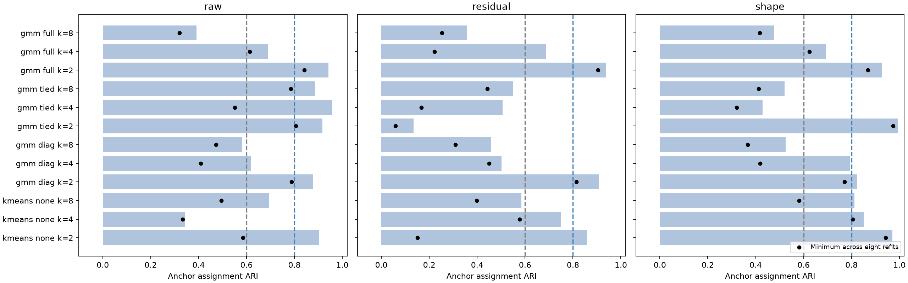
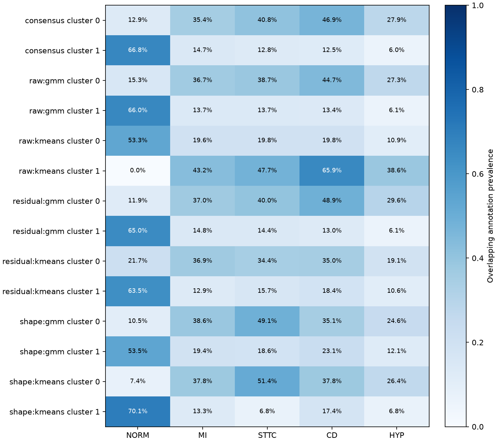
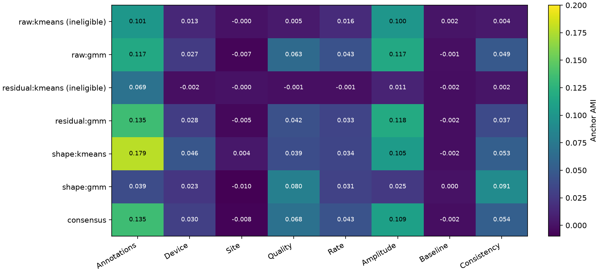

# CLUSTER-02 results: stable mixtures do not persist across morphology views

18 October 2026. The prespecified cross-view robustness gate was **not met**. All three morphology
views produced an eligible, stable two-component Gaussian mixture, and the anchor consensus was also
eligible. However, the amplitude-normalized shape partition agreed weakly with the raw and residualized
mixtures (anchor ARI 0.272 and 0.205, below 0.50). Stability within a representation therefore did not
establish persistent morphology organization across these representations. This is an exploratory
training-cohort result, not a clinical diagnosis, disease mechanism or independent test.

The [protocol](cluster-02-stability-selection.md) was committed as `a5ad5d6` before new scores, and the
implementation as `b08811a` before execution. One complete run took 20.09 seconds with two numerical CPU
threads, no GPU, no new dependencies/downloads and no waveform reads. There was no failed or partial run,
score-driven tuning, winner substitution, push or PR. The [aggregate receipt](../reports/cluster02_stability_selection.json)
contains all 36 candidate configurations, all gates, eight-refit ARIs, post-selection associations,
enrichments, provenance and final verification. Original identifying tables and assignment matrices remain
local under `outputs/cluster02_stability_selection/`.

## Integrity, cohort and fitting boundary

The exact CLUSTER-01 result hash, six immutable predecessor artifacts and two metadata files matched.
The original CLUSTER-01 raw and residualized k-means assignments were reproduced with ARI 1.0 in both
views; silhouette absolute errors were 2.78e-16 and 5.55e-17. Its known mutable-status hash defect was
excluded as prospectively specified. No predecessor artifact was changed.

| Check | Executed value |
| --- | ---: |
| Exact CLUSTER-01 analyzed cohort | 1,999 patients / ECGs |
| Fitting pool | 1,587 patients |
| Internal development anchors | 412 patients |
| Each of eight 80% fitting subsamples | 1,269 patients |
| Fixed morphology features | 53 |
| Reference models and complete-pipeline refits | 36 + 288 |
| Nonconverged configurations | 0 |
| Eligible configurations | 9 / 36 |
| Anchor patients with >=2 abnormal superclasses | 87 / 412 (21.1%) |
| Anchor NORM / MI / STTC / CD / HYP counts | 196 / 91 / 94 / 102 / 57 |

Every patient belonged to the copied PR67 training reservation and PTB folds 1–8, with one ECG per patient.
The deterministic SHA-256 anchor rule was reproduced independently. All reference and refit preprocessing
statistics and model parameters were fitted on the corresponding fitting rows only; unknown anchor device
and site categories map to zero indicator blocks. The three views shared patient draws and model inputs
within each view/draw. The 16-component PCA cap bound all reference views, retaining 92.13% raw, 90.76%
residualized and 91.60% shape variance.

Anchors were excluded from new fitting but used for selection. CLUSTER-01 already used the entire cohort,
so these anchors are exploratory development selection observations, not an untouched test. No age/sex
subgroups or clinical label definitions changed. Diagnosis codes were parsed only after the unsupervised
choices and gate decision were saved.

## Prespecified selection

All selected models used k=2. A row marked ineligible is the fixed descriptive fallback, not a passing
baseline. ARIs compare each reference prediction with eight complete-preprocessing refits on the same
412 anchors; their range is not a confidence interval.

| View and family | Selected covariance | Anchor sizes | Silhouette | Minimum / median / maximum ARI | Eligible |
| --- | --- | --- | ---: | --- | --- |
| Raw k-means | — | 368 / 44 | 0.369 | 0.585 / 0.902 / 1.000 | No: minimum ARI |
| Raw mixture | Full | 150 / 262 | 0.196 | 0.841 / 0.942 / 0.971 | Yes |
| Residualized k-means | — | 157 / 255 | 0.113 | 0.151 / 0.859 / 0.933 | No: minimum ARI |
| Residualized mixture | Full | 135 / 277 | 0.185 | 0.904 / 0.937 / 0.971 | Yes |
| Shape k-means | — | 148 / 264 | 0.172 | 0.942 / 0.971 / 0.990 | Yes |
| Shape mixture | Tied | 57 / 355 | 0.201 | 0.974 / 0.993 / 1.000 | Yes |
| Anchor consensus | — | 147 / 265 | 0.199 | 0.849 / 0.933 / 0.981 | Yes |

Eligible configurations were raw diagonal/full mixture k=2, residualized diagonal/full mixture k=2,
shape k-means k=2/4 and shape diagonal/tied/full mixture k=2. The fixed stability-first ranking selected
full covariance for raw/residualized morphology and tied covariance for shape. All 36 candidates and
failed conditions are recorded in the aggregate JSON and local `candidate_table.csv`; no configuration
was chosen using annotations or nuisance associations.

Consensus was admitted because all three selected mixture views were eligible. The k=4 consensus failed
reference/refit cluster-size requirements despite minimum/median ARI 0.899/0.941. The k=8 consensus failed
size and separation requirements (silhouette -0.162). Thus the eligible k=2 consensus was selected even
though the larger, ineligible partitions had higher median ARI. Consensus has no out-of-sample clinical
prediction rule.



## Frozen decisions

| Primary robustness condition | Executed result | Passed |
| --- | --- | --- |
| All three selected mixture views eligible | 3 / 3 | Yes |
| Every pairwise anchor ARI >=0.50 | Raw/residual 0.686; raw/shape 0.272; residual/shape 0.205 | No |
| Eligible consensus | k=2 | Yes |

The primary conclusion is negative/inconclusive for persistence across representations. A stable
consensus cannot repair the failed pairwise agreement requirement.

The residualized mixture's minimum ARI exceeded the residualized k-means fallback by 0.753 (0.904 versus
0.151). The secondary success rule required **both** partitions to be eligible; the baseline was not.
The prespecified secondary improvement is therefore also false. The numerical contrast can be described,
but does not constitute a successful gated comparison.

## Post-selection annotations and nuisance factors

NORM, MI, STTC, CD and HYP remained overlapping flags. The following are anchor prevalences, not a
mutually exclusive diagnosis classification. Rows for raw/residualized k-means describe ineligible
fallbacks and cannot support either success claim.

| Partition / cluster | n | NORM | MI | STTC | CD | HYP | >=2 abnormal classes |
| --- | ---: | ---: | ---: | ---: | ---: | ---: | ---: |
| Raw k-means 0 | 368 | 53.3% | 19.6% | 19.8% | 19.8% | 10.9% | 16.0% |
| Raw k-means 1 | 44 | 0.0% | 43.2% | 47.7% | 65.9% | 38.6% | 63.6% |
| Raw mixture 0 | 150 | 15.3% | 36.7% | 38.7% | 44.7% | 27.3% | 44.7% |
| Raw mixture 1 | 262 | 66.0% | 13.7% | 13.7% | 13.4% | 6.1% | 7.6% |
| Residualized k-means 0 | 157 | 21.7% | 36.9% | 34.4% | 35.0% | 19.1% | 33.1% |
| Residualized k-means 1 | 255 | 63.5% | 12.9% | 15.7% | 18.4% | 10.6% | 13.7% |
| Residualized mixture 0 | 135 | 11.9% | 37.0% | 40.0% | 48.9% | 29.6% | 48.1% |
| Residualized mixture 1 | 277 | 65.0% | 14.8% | 14.4% | 13.0% | 6.1% | 7.9% |
| Shape k-means 0 | 148 | 7.4% | 37.8% | 51.4% | 37.8% | 26.4% | 43.2% |
| Shape k-means 1 | 264 | 70.1% | 13.3% | 6.8% | 17.4% | 6.8% | 8.7% |
| Shape mixture 0 | 57 | 10.5% | 38.6% | 49.1% | 35.1% | 24.6% | 40.4% |
| Shape mixture 1 | 355 | 53.5% | 19.4% | 18.6% | 23.1% | 12.1% | 18.0% |
| Consensus 0 | 147 | 12.9% | 35.4% | 40.8% | 46.9% | 27.9% | 45.6% |
| Consensus 1 | 265 | 66.8% | 14.7% | 12.8% | 12.5% | 6.0% | 7.5% |

One Benjamini-Hochberg family covered all 70 one-sided cluster-by-label Fisher tests across the six
selected view/family partitions and eligible consensus. Residualized mixture cluster 0 showed lifts of
1.677 for MI (q=1.72e-6), 1.753 for STTC (q=5.38e-8), 1.975 for CD (q=1.15e-13), and 2.142 for HYP
(q=2.41e-9). Shape mixture cluster 0 showed MI/STTC/HYP enrichment (lifts 1.747/2.153/1.775;
q=0.00377/5.60e-6/0.0283), whereas CD was not significant after correction (lift 1.417, q=0.0808).
These co-occurrences describe the partitions after selection; they do not rescue the failed gate.



Anchor AMI with annotation combinations and prespecified nuisance factors:

| Partition | Annotation combination | Device | Site | Quality | Rate quartile | Amplitude quartile | Baseline quartile | Consistency quartile |
| --- | ---: | ---: | ---: | ---: | ---: | ---: | ---: | ---: |
| Raw k-means (ineligible) | 0.101 | 0.013 | -0.000 | 0.005 | 0.016 | 0.100 | 0.002 | 0.004 |
| Raw mixture | 0.117 | 0.027 | -0.007 | 0.063 | 0.043 | 0.117 | -0.001 | 0.049 |
| Residualized k-means (ineligible) | 0.069 | -0.002 | -0.000 | -0.001 | -0.001 | 0.011 | -0.002 | 0.002 |
| Residualized mixture | 0.135 | 0.028 | -0.005 | 0.042 | 0.033 | 0.118 | -0.002 | 0.037 |
| Shape k-means | 0.179 | 0.046 | 0.004 | 0.039 | 0.034 | 0.105 | -0.002 | 0.053 |
| Shape mixture | 0.039 | 0.023 | -0.010 | 0.080 | 0.031 | 0.025 | 0.000 | 0.091 |
| Consensus | 0.135 | 0.030 | -0.008 | 0.068 | 0.043 | 0.109 | -0.002 | 0.054 |

Negative AMI is possible after chance adjustment. The most stable shape mixture was associated more
strongly with quality/beat consistency than annotation combinations. Its relatively weak amplitude AMI
and disagreement with other views illustrate that stability can select a different organization.
Residualized mixture amplitude AMI remained 0.118. Linear residualization does not establish independence;
amplitude normalization and residualization can also remove real physiology.

The residualized mixture-minus-k-means annotation AMI difference on anchors was 0.06573, with a 200-draw
whole-patient percentile bootstrap interval [0.02244, 0.12180]. This is conditional on selected/fitted
partitions, including an ineligible baseline. It excludes zero but is not an independent endpoint or
an uncertainty interval over complete selection and fitting. Full-cohort descriptive annotation AMIs
were 0.102/0.124 for raw k-means/mixture, 0.080/0.131 for residualized k-means/mixture and 0.183/0.025 for
shape k-means/mixture. Those observations include fitting patients and provide no held-out confirmation.



## Verification, limitations and reproduction

Eleven focused tests passed in 2.01 seconds and focused Ruff passed before source freeze. Tests cover
anchor allocation, fitting-only transformation state, unknown categories, per-record amplitude invariance,
cluster collapse and size requirements, worst-refit/convergence gates, stability-first selection,
label-number invariant consensus, rejection of ineligible consensus components and delayed diagnosis
interpretation.

A separate post-execution artifact audit verified all 11 frozen source hashes against disk and the source
commit, nine input hashes, nine immutable output hashes, final result/status binding, exact patient row
alignment, PR67 membership, unique patient/ECG identities, all sample hashes, all 36 candidate identities,
288 anchor prediction refits, size/stability eligibility, selections, pairwise ARIs, global BH correction
and enrichment cluster sizes. It read no waveforms and fitted no model. All checks passed; the final
verification is included in the aggregate receipt. The frozen runner now excludes mutable status from
immutable output hashing and binds final status to the completed result hash.

The original result SHA-256 is
`945b2fc803236badbd934133a685105e91f124f017142c669921efa494dc56ed`.
The environment used NumPy 2.4.6 and scikit-learn 1.9.1. No runtime warnings were emitted.

This comparison demonstrates stable coarse partitions under individual feature definitions, together with
a failed prospective cross-view robustness rule. All patients come from one PTB source and were already
used in CLUSTER-01; heuristic feature extraction lacks expert boundary validation; the internal anchor
set supports model selection; and eight refits are a limited robustness sample. Site metadata is not an
independent hospital experiment. Annotation overlap is preserved, but it neither identifies causality nor
changes the screening label definition. No clinical deployment or transfer claim follows.

For reproduction with the same local immutable inputs and environment, use a fresh output directory:

```bash
PYTHONPATH=/tmp/ecg-cluster01 UV_CACHE_DIR=/tmp/ecg-cluster02-uv \
OMP_NUM_THREADS=2 OPENBLAS_NUM_THREADS=2 MKL_NUM_THREADS=2 \
MPLCONFIGDIR=/tmp/ecg-cluster02-mpl uv run --no-sync \
  python -m scripts.experiments.run_clustering02 \
  --output outputs/cluster02_stability_selection_replay
```

Follow-up ideas for the coordinator's backlog: validate heuristic feature and beat-consistency reliability
before interpreting the shape mixture; prospectively compare annotation-relevant and quality-associated
morphology in a separately permitted cohort; retain sensitivity views because amplitude can represent
physiology as well as acquisition effects. No further analysis or experiment was run.
