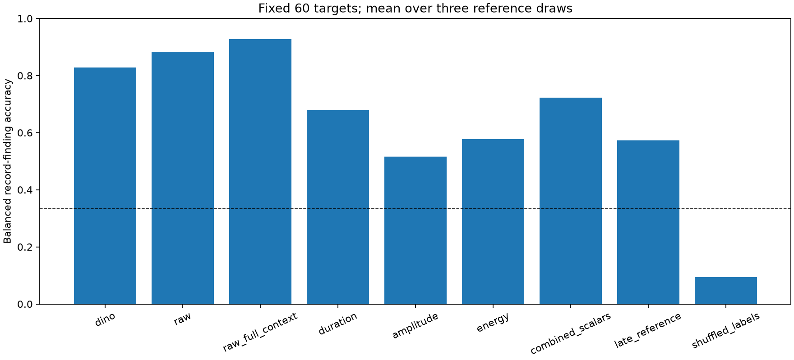
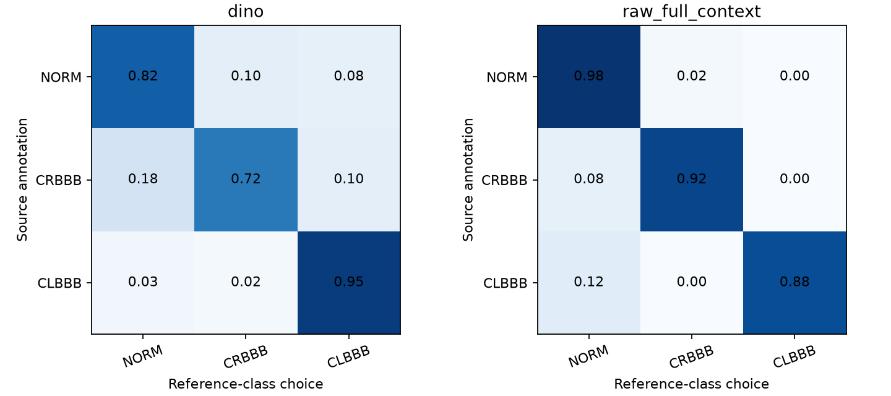

# NTT-04 results: raw physical references outperform the compact visual representation

18 October 2026. On 60 permitted target patients with automatically centered QRS regions, frozen DINO
reference matching reached **82.78% balanced record-finding accuracy**, while raw full-median-beat
matching reached **92.78%**. The primary difference was **−10.00 percentage points**, with a paired
patient-bootstrap 95% interval **[−17.73, −2.34] points**. The frozen visual advancement gate failed.
This is a reference-classification result for source annotations, not a localization or disease-cause test.

The [protocol](ntt-04-same-wave-finding-discrimination.md) was committed as `8846650`, and the
[full-context comparator amendment](ntt-04-amendment-context-control.md) with source/tests as `2431012`
before any new cohort counts, waveform extraction or scores. Independent scientific preflight passed.
The single scored execution took **55.98 seconds** on two CPU threads, with no GPU, download, new
library, weight training, push or PR. No method, patient, rendering or threshold was tuned after scores.

## Same-wave task and exact reservations

NTT-03 had matched six nominated windows but tied a generic QRS-phase comparator. Its frozen saved
counts reproduced exactly before the new score: full-view real/wrong 6/2, crop-view 6/0, and the three
proposal oracles 0.016/0.014/0.879198. No model replay, broad NTT-01 label audit or closed evaluation
was needed. NTT-04 instead assigns every record the same automatically detected QRS-centered region;
it is not choosing a QRS from options of different wave types.

Before parsing diagnoses, the runner verified shared manifest/policy/metadata hashes and exact equality
of all 13,938 PR67 train ECGs / 12,078 patients. Whole patients touching folds 9/10 and all reserved
validation/engineering-test roles were excluded. Each permitted patient's lowest ECG ID was chosen
before labels were parsed. No Challenge, EchoNext, ECGAD, MIMIC or SPH record was used.

The fixed finding rule required CRBBB or CLBBB source code confidence >=50, excluded records listing
both complete-BBB codes at any confidence, and used the unchanged existing strict `project_label == 0`
normal rule. It did not redefine the project's screening binary target or classify isolated high voltage.
These are existing human-read source annotations, not newly adjudicated clinical diagnoses.

| First-record cohort and fixed pools | NORM | CRBBB | CLBBB |
| --- | ---: | ---: | ---: |
| Eligible patients | 4,307 | 291 | 261 |
| Independent support pool | 2,149 | 143 | 135 |
| Independent target pool | 2,158 | 148 | 126 |
| Selected targets | 20 | 20 | 20 |
| Supports per fixed draw | 3 | 3 | 3 |

There were 4,859 eligible first records and 7,219 outside this three-finding task; no first record
listed both complete-BBB codes. Hash rules selected 60 unique target patients and three fixed draws of
three support patients per class. In this execution all 27 support patients were distinct across draws,
so 87 unique waveforms were processed. No target was a support in any draw. These remain exploratory
PTB development patients inside PR67 train, not a new independent hospital or clinical final test.

## Representation and controls

Every selected 500 Hz physical mV recording passed the frozen quality rule: at least three complete
beats for the shared all-lead QRS detector and median-beat helper. No record was replaced. Complete
beat count ranged from 7 to 20, median 11; median-beat correlation ranged from 0.689 to 1.000, median
0.993. The fixed baseline was samples 10:50, corresponding to [-0.28,-0.20) seconds before the automatic
center. QRS duration remained a heuristic all-lead measurement, not specialist delineation truth.

All classes used canonical V1 and V6 in identical 518-square images, full median-beat time span
[-0.30,+0.65), physical +/-3 mV per panel and two-pixel black traces. The encoder was the same cached
DINOv2-S/14 source and checkpoint used by NTT-03; the complete DINO Python-file set and bytes had to
match that frozen receipt, not merely a revision label. SAM was not loaded. The programmed pooling
ROI was [-0.15,+0.15] seconds relative to the automatic QRS-energy center.

DINO tokens are globally contextual: QRS-ink pooling does not remove P/T or other full-image context.
The raw full-context comparator was therefore added prospectively before scoring, alongside raw QRS
cosine matching and the fixed duration/amplitude/derivative-RMS scalar baselines. All used the identical
three-patient support draws, with no target-fitted transform or learned prototype weights. The image
clipped four selected records (two CLBBB supports and two CLBBB targets); the largest clipping fraction
was 2.21%. Raw physical vectors were not clipped. Thus this tests a fixed rendering pipeline, not an
intrinsic comparison of all possible visual and native representations.

The late-reference control pooled a separate 300 ms support region [+0.25,+0.55] but retained target
QRS pooling. Late morphology and globally contextual tokens can retain finding information; this is
not a known pathological-negative region. The cyclic control relabeled the same support banks
NORM -> CRBBB -> CLBBB -> NORM, with the target labels unchanged.

## All prespecified methods and support draws

Balanced accuracy averages each patient's correctness over three reference draws, then gives the
three findings equal weight. There are **60 unique target patients and 180 patient-draw predictions**;
the confusion counts are not 180 independent patients. No majority-vote ensemble endpoint was substituted.

| Method | Mean balanced accuracy | Draw 20261018 | Draw 20261019 | Draw 20261020 |
| --- | ---: | ---: | ---: | ---: |
| DINO QRS-pooled, full context | 82.78% | 85.00% | 83.33% | 80.00% |
| Raw physical QRS | 88.33% | 91.67% | 78.33% | 95.00% |
| Raw physical full median beat | 92.78% | 91.67% | 88.33% | 98.33% |
| QRS duration | 67.78% | 50.00% | 71.67% | 81.67% |
| QRS peak-to-peak amplitude | 51.67% | 56.67% | 48.33% | 50.00% |
| QRS derivative RMS | 57.78% | 61.67% | 56.67% | 55.00% |
| Combined five scalars | 72.22% | 76.67% | 68.33% | 71.67% |
| Late-wave reference control | 57.22% | 61.67% | 53.33% | 56.67% |
| Cyclic support-label control | 9.44% | 11.67% | 8.33% | 8.33% |



Raw full-context morphology was the best of the six prespecified baselines. In every bootstrap draw,
the primary comparison reselected the maximum baseline accuracy rather than conditioning on its
observed winner. All 2,000 whole-patient draws contained all three findings; zero draws were skipped.
The −10.00-point estimate and negative upper interval limit fail the prespecified >=5-point gain and
positive-lower-bound conditions. The point threshold uses exact rational class/count arithmetic to
handle an exactly five-point difference without a floating-point boundary error.

The bootstrap keeps all three predictions of a sampled patient together. It conditions on these fixed
support banks, automatic detector and source cohort; it does not quantify uncertainty over new reference
banks, a new hospital, annotation quality or a new clinical population. Three support draws describe
sensitivity, not a confidence interval over every possible reference bank.

| Method | NORM recall | CRBBB recall | CLBBB recall |
| --- | ---: | ---: | ---: |
| DINO QRS-pooled, full context | 81.67% | 71.67% | 95.00% |
| Raw physical QRS | 98.33% | 91.67% | 75.00% |
| Raw physical full median beat | 98.33% | 91.67% | 88.33% |
| QRS duration | 100.00% | 60.00% | 43.33% |
| QRS peak-to-peak amplitude | 41.67% | 40.00% | 73.33% |
| QRS derivative RMS | 56.67% | 46.67% | 70.00% |
| Combined five scalars | 78.33% | 58.33% | 80.00% |
| Late-wave reference control | 50.00% | 21.67% | 100.00% |
| Cyclic support-label control | 8.33% | 18.33% | 1.67% |

Class behavior was heterogeneous: DINO's CLBBB recall was 95.00% versus 88.33% for raw full context,
while raw full context did better on NORM and CRBBB. This is a descriptive decomposition of the fixed
three-class experiment. It does not reverse the primary gate or validate a class-specific fusion.

DINO's aggregate confusion counts, rows true NORM/CRBBB/CLBBB and columns reference NORM/CRBBB/CLBBB,
were `[49,6,5]`, `[11,43,6]`, `[2,1,57]`; raw full context gave `[59,1,0]`, `[5,55,0]`, `[7,0,53]`.
Every row contains 60 patient-draw predictions from 20 people. Numeric count and row-normalized
confusions for all nine methods are retained in the aggregate receipt.



## Co-occurrence and limits of the endpoint

All 20 CRBBB and all 20 CLBBB targets carried a CD superclass annotation. Among CRBBB targets, 12
also carried MI, three HYP and one STTC; among CLBBB targets, two carried MI, three HYP and one STTC.
All 20 normal targets carried NORM alone under the strict existing rule. These superclass-presence
counts preserve the existing annotation helper's convention and are not new disease diagnoses.

The co-occurrence imbalance matters: discrimination of these record labels does not isolate BBB-specific
morphology or an etiology. A reference method can use correlated abnormalities and source artifacts.
The experiment removes the earlier generic wave-type-choice ceiling, but programmed masks and record
labels still cannot validate precise pathological highlighting, expert evidence agreement, beat-specific
abnormality or autonomous diagnosis. The fixed first target's local example shows the programmed QRS
and late masks with a saved exact coordinate record; it was selected without inspecting predictions.
No raw trace or patient identifier was committed.

## Checks and reproducible artifacts

The portable [aggregate receipt](../reports/ntt04_same_wave_summary.json) includes every method, draw,
class recall and confusion matrix, while omitting patient identities and per-record waveform paths.
The original local [result](../outputs/ntt04_same_wave/result.json) SHA256 is
`79cfa5130ccc8d275e398ddb15b056a1affe1beb812fa32c52e12a8c2211e789`.
Input, source, physical waveform, public checkpoint and immutable-artifact hashes are in that receipt.
The DINO checkpoint SHA256 remains
`b938bf1bc15cd2ec0feacfe3a1bb553fe8ea9ca46a7e1d8d00217f29aef60cd9`.

The 21 focused new/predecessor tests passed, covering confidence/conflicts, reservation and label-parse
quarantine, patient-disjoint draws, exact physical baseline/ROI geometry, no replacement, prototype and
cyclic-label semantics, and the exact five-point boundary. Repository-wide Ruff passed. The coordinator's
full integrated CPU suite passed 1,304 tests with six skipped in 72.99 seconds.

Independent read-only reconstruction from saved features reproduced every one of the nine methods'
prototype/scalar scores exactly, all 180 predictions, cohort/reference hash selection, all confusion and
recall values, the best baseline and the complete selection-aware 2,000-draw bootstrap/gate. All declared
source and immutable output hashes matched. The reviewer did not reload models or waveforms. The only
runtime warnings were the expected unavailable optional xFormers acceleration paths; CPU inference used
the existing PyTorch path. No score or source was changed after this check.

Reproduce with the existing cached public model/data in a fresh directory:

```bash
PYTHONPATH="$PWD" UV_CACHE_DIR=/tmp/ecg-ntt04-uv \
OMP_NUM_THREADS=2 OPENBLAS_NUM_THREADS=2 MKL_NUM_THREADS=2 \
MPLCONFIGDIR=/tmp/ecg-ntt04-mpl CUDA_VISIBLE_DEVICES='' \
uv run --no-sync python -m scripts.reports.same_wave_ntt04 \
  --manifest outputs/ntt04_same_wave/reservation_manifest_local.json \
  --policy outputs/ntt04_same_wave/reservation_policy_local.json \
  --output outputs/ntt04_same_wave_replay
```

The negative admission decision supports retaining the simple physical prototype as a strong control,
not declaring the compact visual model useless in every ECG task. Any later claim about specialist-level
finding recognition or evidence localization needs a new prospective study with appropriate independent
annotations, source controls and multiple acceptable evidence regions. Root owns ranked follow-ups; no
post-hoc fusion, extra model or follow-up evaluation was run here.
