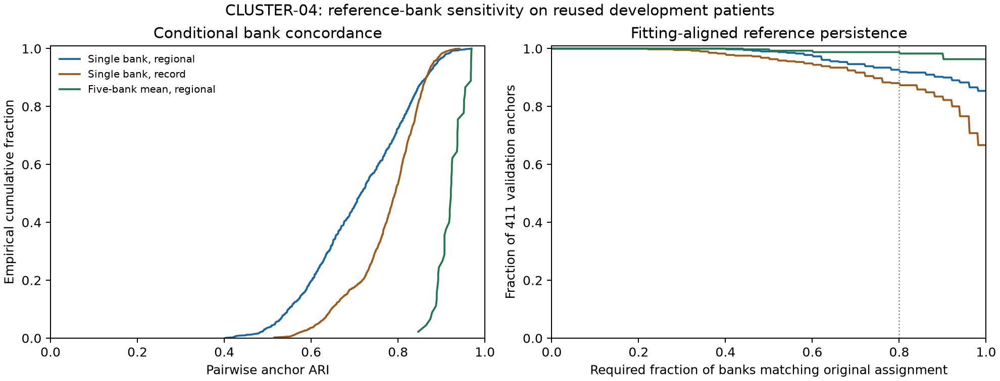
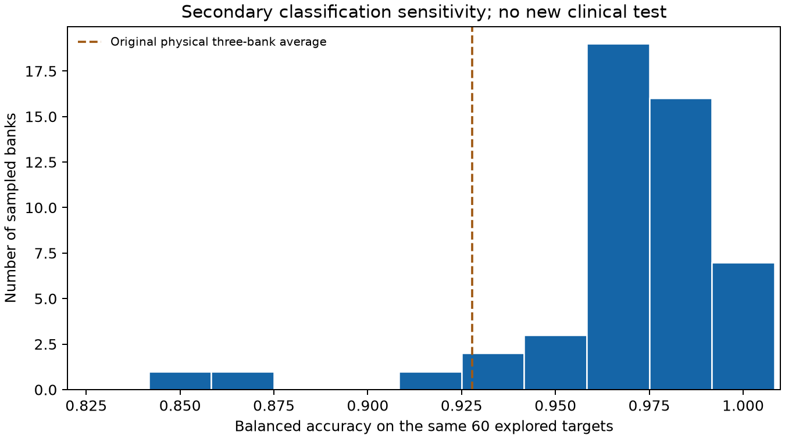

# CLUSTER-04 results: most assignments persist, while bank averaging reduces sensitivity

The prospective conditional reference-bank robustness gate passes. All 50 regional-bank fits were
admissible, the 10th percentile of pairwise anchor ARI was0.54848 (required>=0.50), and381/411 anchors
(92.70%) retained their original CLUSTER-03 assignment in at least 80% of banks (required>=80% of anchors).
This is persistence within the existing 27-support development pool, not independent clinical validation.
CLUSTER-03's stricter cross-view/three-original-bank primary failure remains unchanged.

The [protocol](protocol.md) was committed as `63d583a` before new scores; source was frozen as
`918d513ce885810b02a4945bfff50e30b2a527cd`. Execution took 10.087845 seconds on two CPU threads,
without waveform reads, encoder inference, GPU, downloads or new weights. All 100 single-bank fits and
ten five-bank-ensemble fits completed. Original five selected CLUSTER-03 reference partitions had ARI=1
and zero silhouette error, all three original bank fits reproduced, original affinity error was zero,
and all 180 NTT-06 QRS predictions reproduced with zero score error and 165 correct decisions.

## Primary regional bank sensitivity

The 50 distinct banks each sampled three of nine supports independently within each existing finding.
The cohort remains 1,993 explored development patients, 1,582 fitting and 411 validation anchors; all 27
support patients and whole patients touching source folds9/10 are excluded. Alignment uses fitting
patients only, with deterministic lexicographic permutation ties. Every finite returned partition,
including an inadmissible fit, remains in denominators.

| Quantity | Fifty single banks | Ten five-bank means, secondary |
| --- | ---: | ---: |
| Admissible regional fits | 50/50 | 10/10 |
| Pairwise anchor comparisons | 1,225 | 45 |
| Minimum pairwise ARI | 0.40260 | 0.84651 |
| 10th percentile pairwise ARI | 0.54848 | 0.88802 |
| Median pairwise ARI | 0.71447 | 0.92165 |
| Median ARI against original three-bank partition | 0.80049 | 0.94482 |
| Anchors matching original in at least 80% of banks | 381/411 (92.70%) | 406/411 (98.78%) |

The ensemble result is descriptive: averaging five coordinate views before fitting makes these
partitions less sensitive to the reference draw. It does not validate the partition's clinical meaning.
Draws share supports; ensembles and pairwise comparisons are correlated, so neither 1,225 pairs nor45
pairs are independent statistical observations. No confidence interval is inferred from those counts.
The weakest single-bank agreement with the original partition for one anchor was 44%; no uncertain
anchor was removed. Median aligned entropy was zero, with maximum 0.99885 bits.

## Posthoc check by original cluster

The global persistence percentage conceals uneven sensitivity. After the primary result was frozen,
a descriptive check stratified the saved agreement values by the original regional clusters, without
new fitting or diagnostic labels. The larger group had 356/368 stable anchors (96.74%) with single
banks, versus 365/368 (99.18%) with five-bank means. The smaller group had only 25/43 (58.14%) stable
anchors with single banks, versus 41/43 (95.35%) with five-bank means. This strengthens the practical
case for examining averaging, while qualifying any claim of uniformly robust single-bank groups.

This was not a prespecified subgroup success criterion and cannot change the primary decision.
The groups are algorithmic partitions, not disease categories. The aggregate-only
[posthoc table](../../../../reports/clustering/cluster04-bank-robustness/posthoc_cluster_persistence.json)
retains denominators and the unchanged-decision qualification.

## Secondary record geometry and recognition

The fixed three-axis record-affinity full-GMM k=3 configuration was admissible in 48/50 banks. Both
inadmissible fits converged but failed minimum fitting-cluster occupancy; their anchors and predictions
remain in all50-bank summaries. Pairwise anchor ARI had minimum0.51475,10th percentile0.64652 and
median 0.79320. 362/411 anchors (88.08%) met the80%-of-banks reference agreement criterion. Record and
regional results remain distinct estimands; neither is an exhaustive disease taxonomy.

On the same 60 previously explored class-balanced NTT-06 targets, native-QRS balanced accuracy varied
from 85.00% to100%, with median 96.67% and10th percentile 94.83%.41/60 targets were correct in every bank;
none was wrong in every bank. Complete-right-bundle-branch-block recall ranged 60%–100%, versus 95%–100%
for the existing normal proxy and 90%–100% for complete-left-bundle-branch-block. Bank selection can
therefore matter considerably even when most patients are stable.

The original physical full-context baseline remains 167/180=92.78%. Its support uncertainty was not
resampled. Comparing that original three-bank average with a 50-bank native distribution is conditional
and asymmetric; a favorable median or best bank is not evidence of independent improvement. These
sixty source-annotated targets are neither new patients nor specialist interval labels. No bank was
selected using target accuracy.

After freezing the geometric decision, permitted source annotation-combination AMI had median 0.03490
(range 0.00997–0.05892) for regional banks and 0.10423 (0.06631–0.13427) for record banks. Persistence alone
does not imply a strong disease association. The prior heart-rate/amplitude qualifications remain;
this study did not residualize physiology, estimate disease causes or measure specialist localization.

## Verification and artifacts

An independent agent reconstructed every 100 single-bank and10 ensemble fit, exact labels,
convergence/occupancy/silhouettes, all pairwise ARIs, alignment maps, anchor agreement, entropy and
coassignment matrices. It also reproduced all 50 x 60 native classification predictions, the 167/180
physical count, and both source-annotation AMI distributions. All 38 source, 81 immutable input and
five artifact bindings passed; only the 1,993 permitted source diagnostic payloads were parsed.
Eight focused scientific-invariant tests passed; lint passed. Integrated verification is recorded in
the later session verification report rather than inferred from these focused checks.

The result receipt is `outputs/cluster04_bank_robustness/result.json`, SHA256
`c672be6b2fc9fe6d8c14d974179f04345381b068349df611d1656723e0427baa`.
Private manifests, patient assignments, coassignment matrices and identities stay local.
Public aggregates are [aggregate.json](../../../../reports/clustering/cluster04-bank-robustness/aggregate.json)
and [verification.json](../../../../reports/clustering/cluster04-bank-robustness/verification.json).
The independent detailed audit is `outputs/cluster04_bank_verification/independent_audit.json`.

The useful next step is to carry bank-aggregation uncertainty into a separately frozen matched-scale
study before proposing clinical groups. CLUSTER-05 addresses the dimension/pooling/scale confounds;
NTT-07 prepares independent review infrastructure. Neither an unreviewed packet nor this bank
robustness pass supplies clinical evidence masks. No push or merge occurred; PR#71 remains draft.
