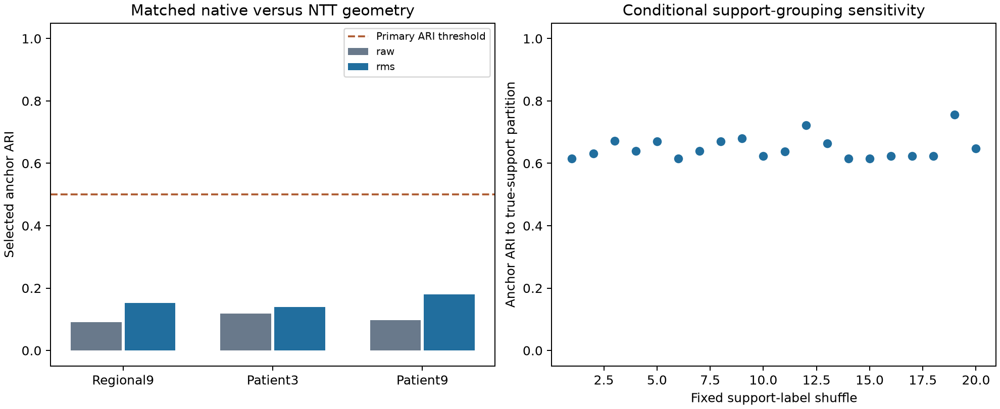

# CLUSTER-05 results: matched dimension and scale do not recover concordance

The prespecified dimension/scale-matched geometric concordance gate failed. Both nine-dimensional
regional winners were eligible, but their validation-anchor ARI was **0.153**, below the required 0.50.
Matching feature count, mean/max/population-standard-deviation pooling and average fitting-coordinate
variance did not make native PCA and NTT regional partitions agree. CLUSTER-03's negative primary
result remains unchanged.

The same native regional partition was selected with and without scalar normalization, while NTT
regional selection changed from tied GMM to diagonal GMM. Every fixed k-means configuration was exactly
invariant to the scalar on every reference/refit anchor partition. Stable groups and support-label
association therefore coexist with substantial dependence on representation and GMM scale settings;
these outputs do not establish disease categories or clinical screening performance.

## Execution and exact integrity

The [protocol](protocol.md) was committed as `24e57f3` after coordinating and independent scientific
review. The implementation was committed as `deca01d`; a stronger synthetic patient-weighting test
was committed as `c3cfb88` before execution. The single completed execution used that final source
commit, two CPU threads, no waveform reads, no encoder inference and no GPU. It completed in 43.3
seconds within its 900-second prospective budget. All 160 configurations, comprising 1,440 grid fits,
completed; every model converged. Eight predecessor reference fits and 23 support-control fits also
completed. No configuration was dropped and no runtime failure or retry occurred.

All 1,993 unchanged development patients passed the existing hash, identity and PR67 training-role
checks. Whole patients touching PTB folds 9/10 and all 27 NTT support patients remained excluded. The
original 1,582 fitting patients, 411 validation anchors and eight 80% fitting-patient subsamples were
reused exactly, with matching sample hashes. Anchors informed model selection but did not enter PCA,
centering, RMS scaling or model fits. They are development validation observations, not untouched test
patients. No protected dataset, age/sex analysis or new clinical label was used.

All five reconstructed raw CLUSTER-03 views matched their saved arrays exactly (maximum error 0).
The five original selected reference partitions reproduced with whole-cohort and anchor ARI 1 and
silhouette error 0. All three original individual-bank partitions, fit diagnostics and pairwise ARIs
also reproduced exactly. The original low bank agreement 0.386741 was preserved; the follow-up did not
replace the predecessor's fits or decision.

## Matched views and selected partitions

Native PCA3/PCA9 were fitted to one normalized QRS vector per fitting patient. Component signs were
fixed by their largest-absolute loading before regional maxima were computed. The native regional
view applied PCA3 directions to each unit QRS-region vector and pooled mean/max/population-std into
nine coordinates. The original NTT regional view retained its mean-bank nine summaries. Record views
compared native patient PCA3 against three NTT prototype cosines; native patient PCA9 supplied the
secondary nine-dimensional patient-vector comparison. NTT uses the frozen NORM/CRBBB/CLBBB support
grouping; its three directions do not constitute a complete disease taxonomy. Its source-label
conditioning is part of the representation. The unchanged encoder also retains CLUSTER-03's caveat:
its pretraining cohort lacks an independently auditable patient-level manifest.

Each raw view was centered on its current fitting sample. Its RMS counterpart divided all coordinates
by one fitting scalar, `sqrt(mean(centered_coordinates**2))`, setting average coordinate variance to 1
without whitening. PCA, patient centering and RMS were refitted independently for every subsample.
The original CLUSTER-03 grid, eligibility conditions and stability ranking were applied without target
annotation access.

Every selected winner was eligible. Sizes below refer to the 411 validation anchors; cluster numbers
are arbitrary. Complete candidates, failed conditions and all 45 selected pairwise ARIs are in the
[aggregate receipt](../../../../reports/clustering/cluster05-matched-controls/aggregate.json).

| View | Selected configuration | Anchor sizes | Minimum / median refit ARI | Silhouette | Eligible configurations / 16 |
| --- | --- | --- | ---: | ---: | ---: |
| Native regional 9, raw | k-means, k=2 | 237 / 174 | 0.905 / 0.976 | 0.336 | 8 |
| Native regional 9, RMS | k-means, k=2 | 237 / 174 | 0.905 / 0.976 | 0.336 | 6 |
| NTT regional 9, raw | tied GMM, k=2 | 368 / 43 | 0.935 / 1.000 | 0.551 | 8 |
| NTT regional 9, RMS | diagonal GMM, k=2 | 281 / 130 | 0.951 / 0.990 | 0.395 | 9 |
| Native patient 3, raw | k-means, k=2 | 165 / 246 | 0.905 / 0.952 | 0.346 | 9 |
| Native patient 3, RMS | diagonal GMM, k=2 | 160 / 251 | 0.905 / 0.957 | 0.351 | 9 |
| NTT record 3, raw | full GMM, k=3 | 329 / 54 / 28 | 0.887 / 0.992 | 0.524 | 8 |
| NTT record 3, RMS | tied GMM, k=2 | 365 / 46 | 0.969 / 1.000 | 0.548 | 10 |
| Native patient 9, raw | k-means, k=2 | 171 / 240 | 0.905 / 0.966 | 0.221 | 5 |
| Native patient 9, RMS | k-means, k=2 | 171 / 240 | 0.905 / 0.966 | 0.221 | 5 |

| Prespecified matched native versus NTT comparison | Raw anchor ARI | RMS anchor ARI |
| --- | ---: | ---: |
| Regional 9 versus regional 9, primary for RMS | 0.0905 | 0.1529 |
| Patient 3 versus record 3, secondary | 0.1184 | 0.1389 |
| Patient 9 versus regional 9, secondary | 0.0977 | 0.1807 |

All matched comparisons remain below 0.50. The primary specifically requires eligible scaled regional
winners and ARI>=0.50; eligibility passed but concordance failed. Neither the secondary comparisons nor
support/annotation summaries can rescue that result.

## Scale sensitivity, information retained and support controls

All 20 matched fixed k-means configurations (five geometries times four k values) had raw-versus-RMS
ARI 1 on the complete reference population, reference anchors and each of eight anchor refits. Thus
all 180 paired reference/refit anchor partitions passed the expected scalar-invariance check. The
native regional and native patient 9 selected partitions also remained identical across scales.

NTT regional raw-versus-RMS selected-partition ARI was 0.2704; NTT record raw-versus-RMS selected ARI
was 0.5637. Native patient 3 selected ARI was 0.8588. GMM candidates retain the same numerical
`reg_covar=1e-3`, whose strength relative to the feature variance changes under scalar normalization.
Winner selection can consequently change, including the NTT record view's three-versus-two groups.
These results expose a scale/selection dependency; they do not identify a unique physiological reason
for the groups.

A posthoc descriptive comparison, requested after scoring, holds the GMM configuration fixed and
compares only already saved raw/RMS assignments. No new fit was performed. These comparisons were
not a prospective GMM invariance gate and did not enter selection or the primary decision.

| Fixed GMM configuration | Raw versus RMS reference anchor ARI | Whole-cohort ARI |
| --- | ---: | ---: |
| NTT regional 9, tied GMM, k=2 | 0.9367 | 0.8375 |
| NTT regional 9, diagonal GMM, k=2 | 0.4695 | 0.4778 |
| NTT record 3, full GMM, k=3 | 0.5735 | 0.5888 |

All six raw/RMS configurations in this table were eligible. The tied regional partition changed less
than the selected-winner comparison (ARI 0.2704), showing that changing the selected configuration
contributes to that discrepancy. The diagonal regional and full record configurations also changed
with scale when their settings were held fixed. The absolute covariance floor stayed `1e-3` in each
coordinate system. For NTT regional 9, that floor was 0.3872 times the reference fitting average raw
coordinate variance, versus 0.001 after RMS; the corresponding record 3 ratios were 0.1436 and 0.001.
This diagnostic does not isolate that numerical floor from every consequence of GMM fitting. Full reference/refit comparisons
are in the [posthoc diagnostic](../../../../reports/clustering/cluster05-matched-controls/posthoc_scale_diagnostic.json).

| Fitting-derived reference statistic | Value |
| --- | ---: |
| Native regional 9 RMS divisor | 0.118673 |
| NTT regional 9 RMS divisor | 0.050818 |
| Native patient 3 RMS divisor | 0.194167 |
| NTT record 3 RMS divisor | 0.083438 |
| Native patient 9 RMS divisor | 0.142511 |
| Patient-QRS variance explained by PCA3 | 36.82% |
| Patient-QRS variance explained by PCA9 | 59.50% |
| Equal-patient fitting-region variance captured by the PCA3 basis | 10.79% |

Across the reference plus eight refits, PCA3 patient variance retention ranged 36.68–37.05%, PCA9
retention 59.49–59.72%, and equal-patient fitting-region retention 10.70–10.86%. The last diagnostic
used only fitting regions, centered on their equal-patient weighted region mean. Matching dimension
therefore does not match information retained, especially for region variation. PCA directions were
chosen from patient QRS vectors, and the original NTT view averages nonlinear summaries over three
support banks while the native view uses one PCA basis. Those remaining differences prevent attribution
of discordance solely to labeled-reference conditioning.

The selected scaled NTT regional diagonal-GMM configuration converged and met fitting/anchor occupancy
requirements in all three original single-bank fits. Their pairwise anchor ARIs were 0.6381, 0.6939 and
0.6934. These are newly scaled/configuration-conditioned descriptions. They do not replace CLUSTER-03's
original lower bank agreement or overcome the failed native-versus-NTT comparison.

All 20 balanced individual-support-label shuffles rebuilt the prototypes and used the fixed selected
CLUSTER-05 scaled regional configuration, with centering/RMS refitted for each control. Every control
converged and met occupancy requirements. Control ARI to the true-support selected anchor partition
ranged 0.6150–0.7569 (median 0.6389), and silhouettes ranged 0.4205–0.4977 (median 0.4649). Much of the
partition persisted under these support regroupings; reference-label grouping still affected it.
The selected true geometry was used to choose the fixed configuration, so these are conditional
sensitivity descriptions, without a confirmatory permutation p-value.

## Post-selection annotation and nuisance associations

The complete unsupervised decision was saved and hashed before target SCP annotations were parsed;
its hash was unchanged afterward. Existing overlapping superclass-combination AMI was 0.0468 for
native regional 9 and 0.0587 for scaled NTT regional 9. The 20 shuffled-support annotation AMIs ranged
0.0170–0.0283 (median 0.0202), all below the true-support value. This conditional annotation association
is compatible with the reference grouping carrying information about its existing findings; it is
not an independent disease-discovery test or evidence about disease causes.

Native regional 9 associated more strongly with heart-rate quartiles (AMI 0.4048) than with existing
annotation combinations (AMI 0.0468). Scaled NTT regional 9 associations were 0.0360 with heart-rate
quartiles, 0.0609 with signal-amplitude quartiles and 0.0453 with source quality. The complete selected
annotation/device/site/quality/numeric nuisance AMIs are retained in the aggregate receipt. No labels
or nuisance associations selected models, no enrichment significance claim was made, and no clinical
label, athlete criterion or referral operating point was changed.

## Reproducibility and remaining work

| Artifact | SHA256 |
| --- | --- |
| Prospective protocol | `b11d3657e4a9526d206134dd0f37b36df39cdfbc7154d5a64ac308ebf4b9de12` |
| Matched-control domain source | `4d31d6c39bce5d3500187e21ff24b40f65407dba572bc0842c246d13168b4867` |
| Experiment command | `ec7cae1cbc9e934bf435f4d29b315f0e352451b98954ebde1c8bd32531645860` |
| Source-bound tests | `ad84896fbada489060b3ee375c72daf623f341341c1d299cdbb35617deddb439` |
| Local completed result | `cbe2d5af704e6a1ee86ba535ea03e2087bd667b33573ec676952d4e65275f885` |

An independent agent subsequently reconstructed all 1,440 grid fits and 23 support-control fits,
all PCA/center/RMS/region-variance transforms and all annotation/nuisance/control AMIs. Coordinates,
silhouettes, partitions, convergence, occupancy, stability, eligibility and selection reproduced
exactly, with maximum numeric error 0. All 180 k-means scalar comparisons and the three posthoc fixed-GMM
comparisons also reproduced exactly. The aggregate-safe [verification receipt](../../../../reports/clustering/cluster05-matched-controls/verification.json)
records this audit; it used no waveform access, encoder loading or new scientific settings.

The six new synthetic tests and seven frozen predecessor-geometry tests passed; lint and formatting
passed for the new implementation, command, tests and report exporter. The strengthened equal-patient weighting fixture
was rechecked before its source commit. The [report exporter](../../../../scripts/reports/clustering/matched_controls.py)
creates aggregate JSON and the standalone figure without copying identities, fitting indices,
coordinates, PCA loadings or individual feature/input hashes into the tracked report directory.

Exact per-patient coordinates, transforms, assignments, identities, samples, source/input/artifact
hashes and the frozen decision remain local under `outputs/cluster05_matched_controls/`. The coordinator
owns queue/backlog updates. A possible ranked follow-up is fitting PCA directions to equal-patient
weighted regional covariance to address the low 10.79% captured region variance; this would require a
new prospective protocol and cannot be treated as a result or rescue. No additional study, push or
merge was performed, and PR71 remains draft.
