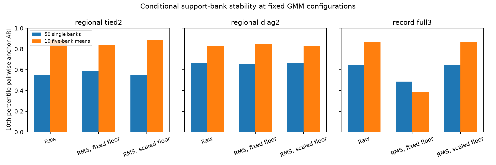

# CLUSTER-06 results: conditional averaging benefit and an exact scale control

The prespecified conditional averaging gate passed for the fixed regional tied GMM k=2 after RMS
normalization. The 10th percentile of pairwise validation-anchor ARI increased from 0.5873 across
50 single banks to 0.8416 across ten five-bank coordinate means, a difference of +0.2542 against the
required +0.10. All 50 single banks and all ten ensembles were admissible. This supports averaging
within this finite development support pool and frozen configuration. It does not reverse the
failed native-versus-NTT concordance results of CLUSTER-03 or CLUSTER-05.

All 183 prespecified coordinate-equivalence comparisons passed. Dividing the absolute covariance
floor by the squared fitting RMS divisor reproduced the raw-coordinate GMM partitions exactly and
the model parameters to numerical precision. Keeping the same numeric floor after normalization
therefore changes the regularized fitting problem; scale sensitivity here is not evidence of a new
physiological group. Averaging was not uniformly beneficial: the full-GMM record view under the fixed
RMS floor had a lower 10th-percentile bank ARI after averaging.

## Execution and integrity

The independently reviewed [protocol](protocol.md) was committed as `ce55355` before scores. Source
and eight synthetic tests were committed as `e63133f` before the single completed execution. Final
preflight review corrected the predecessor's sample-specific replay seeds and ensured empty finite
reference components would be reported explicitly. Neither correction changed the protocol.

The run finished in 26.68 seconds under its 1,200-second ceiling with two CPU threads, 540 factorial
bank/ensemble fits and nine fixed own-reference fits. All 549 new fits converged; no exception,
retry, omitted bank, waveform read, encoder inference or GPU use occurred. Four finite factorial
fits failed occupancy admission: two raw record single-bank fits and their two coordinate-equivalent
counterparts. Their labels remained in all 50-bank denominators. Every other factorial fit and all
nine reference fits were admissible.

The unchanged 1,993 development patients comprised 1,582 fitting patients and 411 anchors. Existing
role/hash gates retained whole-patient fold exclusions and all 27 support-patient exclusions. These
anchors are previously explored development validation observations. No target annotations were
parsed, no clinical labels were changed, and no closed Challenge or EchoNext test data were read.

CLUSTER-03's five selected reference partitions, three original bank fits, original NTT coordinates
and all 180 cached native classification scores reproduced exactly. All 110 CLUSTER-04 bank and
ensemble fits reproduced with ARI 1, exact checks and maximum sensitivity-summary error 0. The six
relevant fixed NTT raw/RMS configurations from CLUSTER-05 reproduced across all nine fitting samples
(54 fits), with ARI 1, coordinate error 0 and reference silhouette errors within 1e-12. These are
replays of the declared predecessors, not new evidence for their decisions.

## Fixed configurations and averaging

Every condition used the same bank manifest, seeds, initialization count, iteration limit and
convergence tolerance. Coordinates were averaged before centering/scaling; centering and one RMS
scalar were fitted separately for each bank or ensemble. No algorithm, component count, bank or
scale was selected from these scores. Pairwise ARIs contain 1,225 dependent single-bank pairs or
45 dependent ensemble pairs; no independent-pair confidence interval is appropriate.

| Fixed configuration | Coordinate condition | Single-bank p10 / median ARI | Five-bank-mean p10 / median ARI | Admissible single / ensemble fits |
| --- | --- | ---: | ---: | ---: |
| Regional tied GMM, k=2 | Raw, floor 1e-3 | 0.5485 / 0.7145 | 0.8880 / 0.9216 | 50/50 / 10/10 |
| Regional tied GMM, k=2 | RMS, floor 1e-3, primary | 0.5873 / 0.7593 | 0.8416 / 0.8970 | 50/50 / 10/10 |
| Regional tied GMM, k=2 | RMS, floor 1e-3/s² | 0.5485 / 0.7145 | 0.8880 / 0.9216 | 50/50 / 10/10 |
| Regional diagonal GMM, k=2 | Raw, floor 1e-3 | 0.6661 / 0.7773 | 0.8312 / 0.8844 | 50/50 / 10/10 |
| Regional diagonal GMM, k=2 | RMS, floor 1e-3 | 0.6585 / 0.7657 | 0.8470 / 0.8841 | 50/50 / 10/10 |
| Regional diagonal GMM, k=2 | RMS, floor 1e-3/s² | 0.6661 / 0.7773 | 0.8312 / 0.8844 | 50/50 / 10/10 |
| Record full GMM, k=3 | Raw, floor 1e-3 | 0.6465 / 0.7932 | 0.8693 / 0.9190 | 48/50 / 10/10 |
| Record full GMM, k=3 | RMS, floor 1e-3 | 0.4861 / 0.6555 | 0.3858 / 0.7764 | 50/50 / 10/10 |
| Record full GMM, k=3 | RMS, floor 1e-3/s² | 0.6465 / 0.7932 | 0.8693 / 0.9190 | 48/50 / 10/10 |

The primary difference was +0.2542243341. Both admission requirements also passed, so all three
prospective conditions were met. The raw tied configuration's improvement was +0.3395, while the
RMS diagonal configuration improved by +0.1885; these are secondary descriptions. The RMS full-GMM
record condition's 10th percentile decreased by 0.1003 even though its median increased by 0.1209.
Reporting only medians would hide that lower-tail disagreement. No secondary result rescues or
changes the frozen primary decision.

## Covariance-scale numerical control

The transformed-floor control compared raw fits against RMS fits with `reg_covar=1e-3/s²`, where
`s=sqrt(mean(centered_fitting_coordinates**2))`. Component alignment used fitting patients alone,
with the same permutation applied to means, weights, responsibilities and diagonal/full component
covariances. Tied covariance has no component axis. Means and covariances were transformed back to
centered raw coordinates; `lower_bound_RMS - d*log(s)` was compared with the raw lower bound.

All 180 single-bank/ensemble comparisons and all three own-reference comparisons had whole-cohort
and anchor ARI 1, matching convergence flags and every prespecified absolute error below 1e-6.

| Quantity | Maximum absolute error across 183 comparisons |
| --- | ---: |
| Raw-coordinate means | 8.88e-16 |
| Weights | 6.66e-16 |
| Responsibilities | 2.78e-14 |
| Raw-coordinate covariance | 1.88e-16 |
| Adjusted lower bound | 1.07e-14 |

The regional own-reference RMS divisor was 0.050818, making the transformed covariance floor
0.387230 rather than 0.001 in RMS coordinates. The record divisor was 0.083438 and transformed
floor 0.143639. In contrast, holding the floor numerically at 0.001 produced own-reference raw/RMS
anchor ARIs of 0.9367 for tied regional k=2, 0.4695 for diagonal regional k=2 and 0.5735 for full
record k=3. Across single banks those fixed-floor raw/RMS median ARIs were 0.8361, 0.5356 and 0.5865.
Thus changing the floor's relative strength is sufficient to reproduce the observed coordinate
dependence under these fixed settings; numerical initialization effects were negligible within the
frozen equivalence tolerances. This is a computational explanation, not a disease mechanism.

## Minority persistence and interpretation limits

Each condition also used its own original three-bank-mean fixed reference. Group names were aligned
using fitting overlap; they are arbitrary identifiers. For the primary RMS tied condition, the
own-reference groups contained 368 and 43 anchors. The fraction agreeing with their own-reference
group in at least 80% of banks rose from 94.8% to 98.9% for the 368-anchor group and from 81.4%
(35/43) to 90.7% (39/43) for the 43-anchor group when averaging five banks.

Against the distinct original CLUSTER-03 partition, the original 43-anchor group's corresponding
persistence rose from 35/43 to 38/43 (88.4%); the original 368-anchor group rose from 94.8% to 99.2%.
The two 43-anchor reference groups have the same size but different membership, so these perspectives
must not be substituted. Raw tied persistence for the original 43 anchors rose from 25/43 (58.1%)
to 41/43 (95.3%). The complete per-group agreement distributions, including low-agreement tails,
are retained in the [aggregate receipt](../../../../reports/clustering/cluster06-bank-scale/aggregate.json).

Preserving the original 43 anchors does not require preserving the whole partition. Under RMS
diagonal k=2, all 43 original minority anchors agreed in at least 80% of banks/ensembles, but only
73.4%/75.0% of the original majority anchors did. Its own-reference minority contained 130 anchors,
illustrating that a larger alternative group can retain a smaller original group. The full record
RMS reference had 277/75/59 anchors; its three own-group persistence fractions were 87.4%/58.7%/55.9%
for single banks and 89.5%/80.0%/66.1% for ensembles. These are morphology-partition descriptions,
without annotation-selected naming or independent clinical interpretation.

The support pool remains nine previously explored patients per existing NTT finding, shared across
overlapping banks, with the same encoder and development cohort. The source-conditioned directions
are not a complete disease taxonomy. The unchanged encoder retains its predecessor's limitation:
its pretraining cohort lacks an independently auditable patient-level manifest. No new annotation,
clinical accuracy, etiology or referral-performance conclusion follows from this stability result.

## Reproducibility

The eight synthetic tests passed, including transformed covariance geometry for tied/diagonal/full
GMMs, fitting-only scaling under extreme anchor changes, minority masking, explicit empty groups,
the primary admission rule and deliberate covariance corruption. Lint and formatting passed for the
new implementation, command, tests and aggregate exporter. Exact bank identities, coordinates,
parameters/responsibilities, assignments, patient splits and all source/input/artifact hashes remain
local under `outputs/cluster06_bank_scale/`. The exporter uses an explicit aggregate allowlist and
does not copy individual identities, vectors or assignments to the tracked report directory.

An independent agent reconstructed all 549 new models and all saved parameters/responsibilities with
maximum error 0, all 183 numerical-equivalence comparisons, all 50 bank coordinate matrices and every
sensitivity/alignment/group/scale-contrast field. The primary decision and signed difference matched
exactly. The aggregate-safe [verification receipt](../../../../reports/clustering/cluster06-bank-scale/verification.json)
records the audit, including unchanged identity/role/support gates and source/input/artifact checks.
The audit used no annotations, waveforms, encoder loading or new scientific settings.

The completed result SHA256 is `554dd9f8e2a7547ef5daef53b8ed1db58f9f21bd6471bce6a0e73a184509b3c6`.
The coordinator owns queue/backlog updates. A possible future protocol could vary ensemble size with
a fixed total support-evaluation budget and diagnose the RMS full-record lower-tail failure; neither
was run here. No push, merge, external contact, data upload or expert review was performed.
