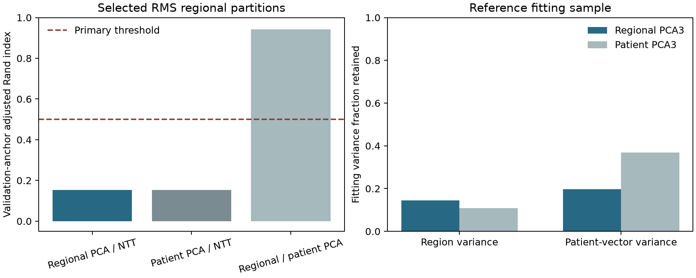

# CLUSTER-07 results: regional covariance retains more variation without recovering concordance

The prespecified primary regional concordance gate failed. The equal-patient regional-covariance PCA
and NTT winners were both eligible, but their validation-anchor ARI was 0.153181, below 0.50. Choosing
three directions directly from regional covariance raised retained regional variance from 10.79% to
14.41%, while leaving the selected partition close to the patient-PCA regional control (ARI 0.942296).
The CLUSTER-03 and CLUSTER-05 negative primary decisions remain unchanged.

The new regional partition associated much more strongly with heart-rate quartiles (AMI 0.40193) than
with existing overlapping source-annotation combinations (AMI 0.04781). This is a descriptive finding
on explored development patients. Increased variance retention and stable groups do not establish
clinical categories, specialist localization, disease causes or referral performance.

## Frozen execution and integrity

The [protocol](protocol.md) was committed as `68587c4` after coordinating and independent scientific
review. Source and tests were committed as `e57b133` before execution; independent implementation
preflight found no material blocker. A single completed run took 79.087 seconds within its prospective
1,200-second wall budget, using two CPU threads. There was no scientific run failure, retry,
configuration truncation, waveform read, encoder inference, GPU, download or protected-test access.

The original main-checkout Git metadata was read-only and automatic escalation review timed out.
Before scoring, the work moved into a standalone local shared clone with its own writable Git metadata;
protocol and source commits were made there. The original worktree was preserved. No push or merge
was performed. This setup issue did not change scientific settings or the completed-run denominator.

All existing input, source and artifact bindings and the original identity/PR67 training-role gate
passed. The cohort remained 1,993 patients: 1,582 fitting patients and 411 deterministic validation
anchors. Whole patients touching PTB folds 9/10 and all 27 NTT support patients remained excluded.
The exact eight saved 80% fitting-patient subsamples, each containing 1,265 patients, were reused.
Anchors informed validation selection and are development observations; they never entered fitting
of covariance, PCA, centering, RMS or clustering.

Before new scores, all 1,440 CLUSTER-05 grid fits, 23 support-control fits and eight CLUSTER-03
reference/bank fits reproduced. All 160 predecessor candidate dictionaries matched the original JSON
exactly; every saved grid/support assignment matched exactly, selections and decisions were unchanged,
and reconstructed transform coordinates had maximum error 0. All remaining recorded transform,
control and reference diagnostics passed the frozen tolerance of 1e-12. After the new decision was
saved and hashed, all predecessor annotation/nuisance/control summaries also reproduced. The
selection hash remained unchanged after annotation parsing.

The new study completed all 48 candidates and 432 reference/refit fits. Every new model converged.
Together with predecessor replay this was 1,903 model fits. No candidate was omitted. Full candidate
conditions and the aggregate-safe receipt are in
[aggregate.json](../../../../reports/clustering/cluster07-regional-projection/aggregate.json).

## Selected RMS regional views

Regional covariance used weights 1/(number of fitting patients times that patient's number of regions).
A float64 eigendecomposition selected three unwhitened directions; each direction's first
largest-absolute loading was made positive before mean/max/population-standard-deviation pooling.
The resulting nine patient coordinates were centered and divided by one fitting-derived scalar RMS.
All transformations were independently refitted in each saved fitting subsample. The two controls
used the unchanged CLUSTER-05 patient-PCA regional and frozen mean-bank NTT regional definitions.

All selected candidates were eligible under the unchanged stability, silhouette, convergence and
5% fitting/anchor occupancy conditions. Cluster numbers below are arbitrary.

| RMS regional view | Selected configuration | Anchor sizes | Minimum / median refit ARI | Silhouette | Eligible candidates / 16 |
| --- | --- | --- | ---: | ---: | ---: |
| Regional-covariance PCA3, pooled to 9 | k-means, k=2 | 235 / 176 | 0.8863 / 0.9661 | 0.4944 | 7 |
| Patient-vector PCA3, pooled to 9 | k-means, k=2 | 237 / 174 | 0.9047 / 0.9758 | 0.3361 | 6 |
| NTT mean-bank regional 9 | diagonal GMM, k=2 | 281 / 130 | 0.9511 / 0.9901 | 0.3955 | 9 |

| Selected anchor comparison | ARI |
| --- | ---: |
| Regional-covariance PCA versus NTT, primary | 0.153181 |
| Patient-vector PCA versus NTT, unchanged control | 0.152854 |
| Regional-covariance PCA versus patient-vector PCA | 0.942296 |

The new basis changed the partition little relative to the patient-PCA control and did not make it
concordant with NTT. The larger silhouette is specific to the new geometry and cannot replace the
prespecified cross-view gate. No secondary comparison or annotation association rescues the failure.

## Variance tradeoff and spectral boundary

| Fitting-only statistic | Regional-covariance PCA3 | Patient-vector PCA3 control |
| --- | ---: | ---: |
| Reference equal-patient regional variance retained | 14.4112% | 10.7924% |
| Reference patient-vector variance retained | 19.7889% | 36.8165% |
| Regional retention across reference plus eight refits | 14.3763–14.4801% | 10.6962–10.8570% |
| Patient-vector retention across reference plus eight refits | 19.7083–20.0070% | 36.6759–37.0515% |

The regional basis retained more of its own fitting objective, as expected by construction, while
retaining less patient-vector variation. Even the new three-dimensional basis captured only about
one seventh of regional variance. This does not quantify disease information retained.

Reference eigenvalues three and four were 0.0257794 and 0.0252042. Their gap was 0.000575215, or
2.2313% of eigenvalue three. Across the reference and eight refits, relative gaps ranged
1.8872–3.3242%. None triggered the fixed numerical near-degeneracy flag (gap <=1e-10 times the largest
eigenvalue), although the relatively close boundary still limits strong interpretation of three
unique biological axes. The complete fitting spectra are retained as aggregate diagnostics; the
nine projection/diagnostic operations took 9.767 seconds combined.

Eigenvectors within tied eigenspaces remain library-dependent despite deterministic ordering and
sign orientation. Regional covariance chooses variance axes, whereas NTT uses existing source-label
support grouping and averages nonlinear summaries across three banks. Those remaining differences
prevent attribution of the failed concordance to a single mechanism.

## Post-selection annotation and nuisance descriptions

The complete unsupervised decision was frozen before target annotation parsing. AMIs below describe
existing overlapping NORM/MI/STTC/CD/HYP source-annotation combinations and the unchanged nuisance
variables; numerical nuisance values use the predecessor's quartile grouping.

| Selected view | Annotation-combination AMI | Heart-rate AMI | Signal-amplitude AMI | Quality AMI |
| --- | ---: | ---: | ---: | ---: |
| Regional-covariance PCA | 0.04781 | 0.40193 | 0.04789 | 0.02087 |
| Patient-vector PCA control | 0.04682 | 0.40480 | 0.04187 | 0.01993 |
| NTT regional control | 0.05866 | 0.03596 | 0.06087 | 0.04528 |

Heart-rate association persisted after fitting directions directly to regional covariance. This does
not show that heart rate causes the partition or that removing it would preserve clinically useful
signals. No residualization, enrichment significance claim, clinical taxonomy, age/sex subgroup,
label-definition change or operating-point decision was made. There is no cardiologist-reviewed
interval ground truth in this study. NTT's reference labels and the encoder's previously documented
pretraining-manifest caveat remain limitations.

## Artifacts and validation

| Artifact | SHA256 |
| --- | --- |
| Prospective protocol | `c7cc2f23d4b37598a4262192cfa7f7c0e23ae6205037a8cf18edfac86547ac92` |
| Regional projection domain source | `786c3e5f5b8aea3a5eb1514f8b7e07aa025bf51cdfa69183ba0ba5d3bab464b8` |
| Experiment runner | `9f48aba9c472b697d2b806a2ffcc1423b2bfe853a8d2ba17cbbf2c74acec58a1` |
| Source-bound tests | `81d24fd04bc659ddf86bd27a360e62ff1ce012c4e5a5938d1228fab43e6781c2` |
| Completed local result | `ed3dfe10bdc59e75c1295e686c846292b58e1cb348dc92a0721d90631fc4246b` |

Six new synthetic tests and 13 frozen matched/reference-geometry tests passed (19 total, 17.65 seconds).
They include comparison with an explicit equal-patient covariance formula, disagreement with ordinary
beat weighting, invariance when one patient's region list is duplicated, exclusion of anchor changes,
fixed signs and orthonormality, fitting-only patient variance and rejection of secondary rescue.
Ruff lint and formatting passed for the new source, runner, tests and aggregate exporter.

Private identities, samples, coordinates, basis vectors, assignments and all individual input/artifact
hashes remain under `outputs/cluster07_regional_projection/`. The
[report exporter](../../../../scripts/reports/clustering/regional_projection.py) uses a whitelist to
omit those payloads from tracked aggregates. The coordinator owns queue/backlog updates. A possible
separately frozen follow-up is a label-blind conditional nuisance-sensitivity control that explicitly
preserves the distinction between rate association and disease information; this report does not
authorize it or recommend removing heart-rate signals from a clinical model.
