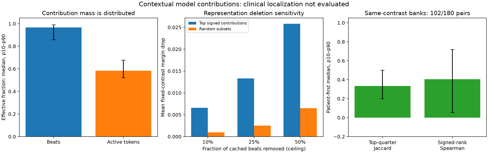

# NTT-08 results: exact contributions are distributed and reference-sensitive

The prespecified engineering gate passed for all 180 original bank-target evaluations. Signed
contextual beat and unique-token contributions reconstruct the frozen classifier's original
winner-minus-runner-up margin within 1.01e-15, against the required tolerance 1e-10. All 87 records'
four descriptors and all original native/historical predictions and summaries replayed exactly.
This supplies an auditable explanation of a model score without requiring new expert annotations.
It does not establish clinically correct abnormality locations.

The important model-behavior finding is that contributions are spread across many beats and their
rankings depend on the reference bank. The patient-first median effective beat fraction was 0.9662;
the largest quarter of absolute beat contributions carried a median 34.39% of absolute mass. Among
bank pairs with the identical ordered finding contrast, the patient-first median top-positive-quarter
Jaccard was only 0.3333. A single hard highlight would conceal the diffuse and reference-sensitive
nature of these contextual score contributions. This interpretation concerns the present model and
pooling, not the true location or extent of an ECG abnormality.

## Frozen execution and exact predecessor replay

The [protocol](protocol.md) was committed as `915a960`, followed by the prospective
[edge-case clarification](edge-cases.md) as `cbec053`. Two independent agents reviewed the mathematics
and implementation before execution. Preflight corrections bound the identity metadata before
reading it, fixed both contrast labels to the saved original score order, and retained both
normalization stages and explicit region/token coordinates in the private output. These changes
occurred before the source/tests commit `9cb711e` and before any new contribution or deletion score.

One completed cached-only execution took 5.817 seconds within the 1,200-second CPU budget, using
two numerical threads. It retained the unchanged 60 targets, three original reference banks and
27 disjoint support patients. All selected patients passed the existing PR67 training-role and
whole-patient PTB fold-9/10 exclusion checks. No target was removed for an incorrect prediction.
There was no waveform parser call, encoder inference, GPU use, download, new label or closed-set
access. A cardiologist is unavailable; zero clinical annotations were created or assumed.

All 348 saved descriptors (87 records times four descriptor types) reproduced with maximum error
zero from the original dense token cache. All native and nine historical methods' saved scores and
choices replayed exactly, including the complete native bootstrap summary. Native QRS remained
165/180 correct and the historical physical baseline 167/180; these are predecessor integrity
counts on already explored development observations, not new accuracy evidence. No new disease
classifier or referral operating point was selected.

| Exact reconstruction quantity | Maximum absolute error |
| --- | ---: |
| Frozen region pooling | 8.33e-17 |
| Original patient QRS descriptor | 8.33e-17 |
| Original three finding scores | 3.33e-16 |
| Sum of signed beat contributions versus original margin | 1.01e-15 |
| Sum of unique signed token contributions versus original margin | 9.92e-16 |
| Within-beat token sum versus its signed beat contribution | 4.17e-17 |

## What the contributions represent

The classifier pools the unchanged V1/V6 automatic QRS regions, normalizes each region vector,
averages the region vectors and normalizes the patient vector before comparing it with unit
reference prototypes. The decomposition explicitly retains both normalizers and fractional
temporal occupancy. Its contrast is the original winner versus original runner-up, with the original
stable finding-index tie rule. Contributions may be negative. Overlapping regions contribute to
the same unique token identity rather than creating additional token observations.

The frozen encoder's 200 ms lead/time anchors retain full ten-second, eight-lead context through
resampling and attention. They are locations of pooled contextual representations, not isolated
receptive fields. Only V1/V6 tokens receive direct pooling weight in this classifier. The other
input leads may still influence those contextual vectors. An unselected token is not a normal label.

All population summaries average each patient's three bank values before describing the 60 people.
The 180 bank-target evaluations are not 180 independent patients. An active token has positive
original pooling occupancy in at least one automatic QRS region, even if its signed contribution
is zero. No mass share is divided by the possibly small classifier margin.

| Patient-first descriptor | Beats, median (p10–p90) | Unique active tokens, median (p10–p90) |
| --- | ---: | ---: |
| Effective fraction of available units | 0.9662 (0.8589–0.9903) | 0.5830 (0.5223–0.6772) |
| Effective count | 9.93 (7.92–13.56) | 31.92 (24.84–40.89) |
| Absolute mass in top 10%, ceiling count | 18.09% (11.74–26.48%) | 28.23% (23.09–32.65%) |
| Absolute mass in top 25%, ceiling count | 34.39% (30.93–43.29%) | 56.91% (49.11–62.29%) |
| Absolute mass in top 50%, ceiling count | 59.31% (53.98–69.12%) | 83.89% (78.67–87.26%) |
| Signed cancellation | 0.0000 (0.0000–0.1080) | 0.0653 (0.0000–0.3103) |

The median available beat count was 11 (range 7–20), and the median active token count was 52
(range 34–88). Effective count describes concentration of absolute contributions, not the number
of clinically abnormal beats. Mean signed V1 and V6 contributions were 0.09739 and 0.05907,
respectively, summing to the mean margin 0.15646. Individual lead contributions could be negative.
These are model- and contrast-specific values, not an independent clinical lead-importance ranking.

## Cached representation deletion and bank uncertainty

Deleting cached beat vectors and renormalizing the remaining patient representation changed the
fixed original contrast more when deleting the largest signed contributions than when deleting
matched random subsets. Every comparison retained the original winner and runner-up; no diagnostic
accuracy or waveform counterfactual was computed. The intervention operates after contextual
encoding. It cannot identify which raw waveform caused the score.

| Deleted beat fraction, ceiling and at least one surviving beat | Mean selected margin drop | Mean random-subset drop | Mean selected-minus-random drop |
| --- | ---: | ---: | ---: |
| 10% | 0.006596 | 0.000964 | 0.005632 |
| 25% | 0.013311 | 0.002497 | 0.010814 |
| 50% | 0.025833 | 0.006507 | 0.019326 |

The study evaluated 100 frozen-seed random subsets per fraction per bank-target pair: 54,000 random
and 540 selected deletions, plus every single-beat deletion. There were no undefined interventions.
The patient-first median correlation between signed contribution ranks and single-deletion drops
was 0.9690. Mean negative single-deletion-drop fraction was 39.56%, despite a mean negative signed
beat-contribution fraction of only 1.96%. Removing a positive contribution can increase the margin
because the surviving aggregate is renormalized. An exact additive contribution is therefore not
interchangeable with a deletion effect. Both analyses share the same score algebra and supply no
independent clinical validation or confirmatory hypothesis test.

Of 180 original bank pairs, 102 retained the identical ordered finding contrast and 78 changed it.
The prespecified same-contrast analysis included 58/60 patients; the other two remained counted as
undefined. The patient-first median signed-rank Spearman was 0.4045 (p10–p90 0.0551–0.7178), and
top-positive-quarter Jaccard was 0.3333 (0.2000–0.5000). All 102 eligible pair metrics were defined.
The differing contrasts were excluded by the prospective semantic rule, not by accuracy or apparent
stability. Near-uniform beat contributions can change rank substantially while changing the total
margin little; no crisp abnormality boundary follows from the top-quarter selection.

## Artifacts, validation and limits

Twenty-two new synthetic invariant/regression cases and four frozen native-study cases passed
(26 total, final focused run 32.98 seconds). They cover fractional overlap, both normalizations,
signed cancellation, active zero-contribution tokens, invalid/mixed-lead inputs, renormalized and
undefined deletions, fixed original contrast ties, deterministic decimal-fraction seeds, empty
positive sets, patient-first summaries, identity rejection before parsing and all coordinate anchors.
Ruff lint and formatting passed before source freeze.

The completed private result is `outputs/ntt08_contextual_contributions/result.json`, SHA256
`0d137e4f8618a99f2d6994179b9ff5b1b3de0d82e309fd6ab4d915d5a3001058`.
The private directory retains all exact contributions, weights, normalizers, original coordinates,
fixed contrasts, sampled subsets and identities. The [aggregate exporter](../../../../scripts/reports/localization/contextual_contributions.py)
uses an explicit allowlist; the tracked [aggregate receipt](../../../../reports/localization/ntt08-contextual-contributions/aggregate.json)
and standalone figure contain no individual signals, coordinates, identifiers or attribution maps.
Only aggregate figures were visually inspected.

The source encoder's pretraining patient manifest remains independently unauditable as documented
by its predecessors. These are explored development observations and weak automatic pooling regions,
with no specialist interval truth. Clinical precision/recall, disease causes and agreement with a
cardiologist remain unmeasured. The useful follow-up is to prospectively test reference averaging
for contextual-contribution stability while fixing each patient's finding contrast, without calling
greater stability clinical validation. No push, merge, clinician contact or data upload occurred.

An independent implementation subsequently rebuilt all 180 decompositions, 54,000 random deletions, 540 selected deletions, every single deletion, all original bank comparisons and the complete patient-first summary. Maximum array error was 4.45e-16, normalizer error 1.78e-15 and aggregate error 2.14e-14; all coordinate and bank-consistency checks were exact. Source/input/artifact hashes and training-role gates passed. Historical replay and bootstrap checks reused frozen predecessor helpers. The [independent verification](../../../../reports/localization/ntt08-contextual-contributions/independent-verification.json) records this scope and its clinical limits.
