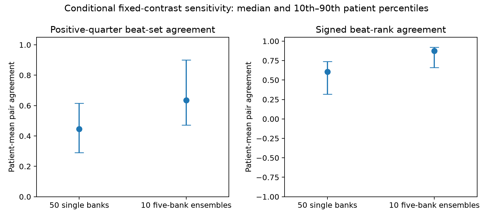

# NTT-09 results: reference averaging stabilizes conditional beat rankings

The prespecified finite-pool stability gate passed. Mean patient-level positive-quarter beat-set
Jaccard increased from 0.4418 across 50 individual reference banks to 0.6559 across ten normalized
five-bank prototype ensembles. The unweighted mean improvement across all 60 patients was
**+0.2141**, above the required +0.10. Every patient had a defined difference and passed both
per-patient pair-coverage requirements. All 60 differences were positive, ranging from +0.0498
to +0.4831. This is conditional ranking stability within a chosen representation and support pool.

The comparison uses more support exposure per ensemble: 15 support slots per finding, with repeated
patients, versus three distinct patients for an individual bank. Ensembles covered 6–9 distinct
support patients per finding, median 8, within the same nine-patient pool. The result therefore does
not establish an averaging benefit at equal support or computational cost. Beat contributions also
remained diffuse: median effective beat fraction increased from 0.9662 to 0.9854, while the top
quarter's absolute-mass share decreased from 0.3402 to 0.3294. More consistent ranks do not imply
that the selected beats contain independently verified pathology.

## Execution and exact reconstruction

The reviewed [protocol](protocol.md), including the unequal-budget qualification, was committed as
`d404cc2` before scores. Source, meaningful synthetic tests and the aggregate exporter were committed
as `b147090` before the single execution. Scientific preflight cleared fixed-contrast projection,
unique-token accounting, normalized prototypes, empty sets, constant ranks, patient weighting and
coverage. The independently reconstructed NTT-08 study had passed its audit before this run began.

The cache-only run finished in 26.29 seconds within its 1,200-second ceiling, using two CPU threads.
All 3,600 declared bank/ensemble-target decompositions completed, with zero failures, exclusions or
retries. The maximum signed beat/token sum error against the fixed cosine margin was 1.44e-15,
below the prospective 1e-10 limit. No waveform, encoder inference, GPU, new clinical annotation,
closed test payload, download or external data transfer was used.

The unchanged cohort comprised 60 targets and 27 disjoint support patients. Existing reservation,
whole-patient role and PTB fold-9/10 exclusions were checked before feature/token consumption. All
87 original cached descriptors and native scores replayed through the frozen helpers. Before the
new comparisons, all 180 NTT-08 original decompositions, contributions, interventions, bank pairs
and complete patient-first aggregate were reconstructed with maximum array and summary error 0.
Original NTT-06 correctness counts were integrity checks, not new accuracy estimates.

## Fixed contrasts and full pair denominators

One unit prototype per finding used all nine available unit support-patient descriptors. Its three
cosines fixed a winner and runner-up for each target, with lower finding index breaking exact ties;
no target had a full-pool winner/runner tie. Every bank and ensemble explained that same ordered
contrast, including negative margins. The contrast was never reranked using bank scores or target
annotations. A five-bank ensemble unit-normalized the mean of its five unit prototypes separately
for each finding; averaging unnormalized scores or contributions would be a different method.

The exact 50 CLUSTER-04 bank draws and ten consecutive five-bank blocks were reused. Each patient's
1,225 single-bank pairs and 45 ensemble pairs entered the corresponding complete denominator. The
positive-quarter set retained strictly positive contributions within the first ceil(B/4) signed
ranks, with original beat index breaking exact ties. One-empty Jaccard was zero and both-empty
Jaccard was null. Defined pairs were averaged within a patient before equal-patient aggregation.

| Primary quantity | Single banks | Five-bank ensembles |
| --- | ---: | ---: |
| Patients retained / with defined patient mean | 60 / 60 | 60 / 60 |
| Pair denominator per patient | 1,225 | 45 |
| Minimum defined pairs within any patient | 1,197 | 45 |
| Required defined pairs within every patient | 1,164 | 43 |
| Undefined positive-quarter pairs, across all patients | 66 / 73,500 | 0 / 2,700 |
| Mean of patient-mean positive-quarter Jaccard | 0.4418 | 0.6559 |
| Median of patient-mean positive-quarter Jaccard | 0.4469 | 0.6352 |
| 10th / 90th percentile of patient-mean Jaccard | 0.2900 / 0.6152 | 0.4713 / 0.9000 |

The primary mean patient difference was +0.2140787087; its median was +0.1943 and its 10th/90th
percentiles were +0.0945/+0.3627. All four frozen conditions passed. The positive-quarter Jaccard
of the least-consistent ensemble patient was 0.3630, so the passing improvement gate does not imply
uniformly high absolute agreement. No independent-pair confidence interval or confirmatory p-value
is justified by these overlapping banks and shared targets.

NTT-08's reported bank-consistency subset required the original banks to choose the same ordered
contrast and covered 102 pairs among 58 people. This study fixes full-nine-pool contrasts and uses
all 60 people and a different, prospectively fixed bank family. Its absolute agreement levels are
not the same estimand as NTT-08's conditional subset; no subtraction from that earlier subset is
presented as an averaging effect.

## Signed uncertainty, diffuse mass and support exposure

Signed-rank and absolute-rank agreement improved alongside the positive-set endpoint. Values below
first average all defined bank pairs within each patient and then summarize the 60 patient means.

| Secondary pair agreement | Single-bank mean / median | Ensemble mean / median |
| --- | ---: | ---: |
| Signed beat-rank Spearman | 0.5686 / 0.6079 | 0.8324 / 0.8768 |
| Absolute beat-rank Spearman | 0.5132 / 0.5509 | 0.8193 / 0.8712 |
| Absolute-quarter beat-set Jaccard | 0.4320 / 0.4469 | 0.6495 / 0.6100 |

All signed/absolute rank comparisons were defined. No exact signed/absolute rank or quarter-boundary
ties occurred for beats or active tokens. Negative fixed-contrast margins were retained:
90/3,000 single-bank evaluations across 18 patients and 2/600 ensemble evaluations in one patient.
The complete margin ranges were -0.1341 to 0.4020 for single banks and -0.0144 to 0.2638 for
ensembles. No margin was exactly zero. A negative margin means the bank reverses this fixed ordered
contrast; it was not converted to a new winner-minus-runner explanation.

Twenty-nine single-bank evaluations had empty positive-quarter sets; none of the ensemble sets was
empty. Both-empty pairs produced the 66 retained null Jaccards. No beat or active-token evaluation
had zero absolute mass. Zero-mass and constant-rank cases remain explicitly represented in the
implementation and outputs; absolute-quarter sets would otherwise be defined by tie order for an
all-zero map and could not be interpreted as stable evidence.

| Median patient-first contribution quantity | Single banks | Ensembles |
| --- | ---: | ---: |
| Effective beat fraction | 0.9662 | 0.9854 |
| Top-quarter beat absolute-mass share | 0.3402 | 0.3294 |
| Beat cancellation | 0.00056 | 0.00000 |
| Effective active-token fraction | 0.5875 | 0.5918 |
| Top-quarter active-token absolute-mass share | 0.5624 | 0.5603 |
| Active-token cancellation | 0.05793 | 0.00834 |
| Mean per-beat signed contribution population SD across banks | 0.004382 | 0.001712 |
| Mean per-active-token signed contribution population SD across banks | 0.001035 | 0.000432 |

For absolute contributions, the corresponding median per-beat SD was 0.004275 versus 0.001712,
and median per-active-token SD was 0.000946 versus 0.000408. These are variability of contextual
score contributions, not calibrated diagnostic uncertainty. Effective beat fractions near one
and modest top-quarter mass remain compatible with ranking improvements because ranks can become
consistent while the total margin is spread across many beats.

Identity-only support accounting confirmed three distinct patients per finding in every single bank.
Five-bank ensembles used 15 slots per finding but only 6–9 distinct patients (mean 7.7, median 8);
across all three findings they covered 22–24 of the 27 supports (mean 23.1, median 23). The full-nine
contrast reference was shared by both arms. Repeated support weights, additional unique supports,
prototype normalization and computation all differ from a single three-shot bank. A matched-union
support control would need a new prospective study to distinguish these factors.

## Scope and reproducibility

The automatic QRS windows and V1/V6 pooling leads are fixed priors inherited from the classifier.
This study explains and stabilizes rankings within that chosen domain; it does not independently
choose among P, QRS, ST and T evidence. Tokens are contextual representations of the original full
record. A contribution attached to a beat or lead/time token cannot be relabeled as an isolated
waveform abnormality or expert annotation. No disease etiology, clinical accuracy or referral
operating-point claim follows, and the failed NTT-06 primary remains unchanged.

Eight new synthetic tests passed. They cover a negative fixed contrast despite a changed bank winner,
overlapping unique-token sums, signed index ties and empty sets, average-rank/constant-rank handling,
each patient's separate coverage requirements, undefined patients, nonunit prototypes, normalized
prototype averaging and nonfinite replay rejection. Twenty frozen NTT-08 contextual-margin tests
also passed during preflight. Lint and formatting passed for the new domain module, runner, tests
and aggregate exporter. Frozen scientific source bytes were preserved after execution.

All per-patient tokens, contributions, maps, pair arrays, original coordinates, identities and
manifests remain local under `outputs/ntt09_reference_contribution_stability/`. The tracked
[aggregate receipt](../../../../reports/localization/ntt09-reference-contribution-stability/aggregate.json)
and figure use explicit aggregate fields and contain no individual identities, token coordinates
or attribution maps. The completed result SHA256 is
`009eacb3c72b0dcfe85e155a9036542cc504e788ddd7179e097860fe4f4e8f64`.

An independent agent reconstructed all 3,600 new decompositions without importing the new production
module. It regenerated the 50 support banks, all full-nine contrasts, normalized ensembles, all
76,200 pairs with four metrics and their null masks, patient/family aggregates, exposure accounting
and the primary decision. Maximum contribution-array error was 6.94e-18 and maximum pair/summary
error was 3.33e-16. The aggregate-safe [verification receipt](../../../../reports/localization/ntt09-reference-contribution-stability/verification.json)
records these checks. That audit verified the original NTT-08 replay bindings and preceding independent
audit; it did not repeat the 54,000 original random deletions again.

The coordinator owns queue/backlog/index updates. A possible follow-up is a prospective matched-union
support comparison that holds unique patients fixed while varying repeated bank weights and prototype
normalization. It was not run here. Independent clinical review remains pending; no expert review,
push, merge, upload or external contact was performed.
