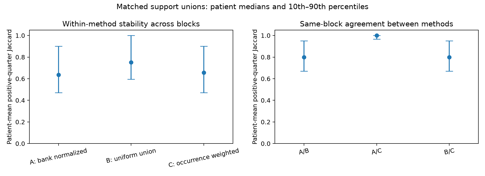

# NTT-10 results: uniform support-union weighting has higher conditional consistency

Uniform weighting of the exact same unique support people was more consistent than the original
normalized-bank aggregation in this finite design. Mean patient-level positive-quarter beat-set
Jaccard was 0.7708 for uniform union B versus 0.6559 for original aggregation A. The prespecified
A-minus-B mean difference was **-0.1150**, beyond the inclusive -0.05 boundary, so the primary
classification was a material conditional consistency advantage for B. All 60 patient differences
were defined, and every patient/method had all 45 pairs defined.

This was not uniform across patients: 42 materially favored B, four materially favored A and 14
were inside the operational resolution band. These categories are engineering descriptions of a
shared support pool, without population equivalence, clinical adequacy or deployment selection.
The result supports examining uniform patient weights in later reference-classifier work; it does
not establish pathological localization or improve a measured clinical detection endpoint here.

## Execution and exact integrity

The [protocol](protocol.md) was independently reviewed and committed as `694acbc` before scores.
Source, 18 new synthetic cases and the aggregate exporter were committed as `99db675` before the
single execution. Final preflight corrected a frozen-helper reporting denominator to 45 pairs,
added explicit margin-sign events and used `math.fsum` for the unweighted patient-effect mean so
the inclusive +/-0.05 boundaries survived floating-point reduction. No threshold tolerance or
result-dependent rule was introduced.

The run completed in 24.35 seconds within its 1,200-second ceiling using two CPU threads. All
1,800 A/B/C target-block decompositions and 600 analytic-A checks completed, with zero failures,
omissions, retries, waveform reads, encoder inferences, GPU use, new annotations or closed-test
access. Maximum beat/token margin-sum error was 1.25e-15. Analytic A's maximum contribution/margin
error was 5.55e-16 and maximum prototype identity error was 8.33e-17, within the prespecified
1e-10 contribution and 1e-12 prototype tolerances.

Before new comparisons, all 3,600 NTT-09 decompositions, original geometry/prototypes, 76,200 pairs
with all four metrics and null masks, complete patient/family aggregates, exposure accounting and
its primary decision reproduced with maximum array and complete-summary error 0. Existing frozen
helpers also replayed all 87 descriptors and original native scores. The prior NTT-08 bindings were
preserved; this successor did not repeat its 54,000 random deletions.

The same 60 targets and 27 disjoint support patients passed existing reservation, training-role
and whole-patient fold-9/10 gates before feature consumption. The 50 original three-shot banks,
ten consecutive five-bank blocks and each target's full-nine-pool ordered contrast remained fixed.
No bank-specific winner/runner reranking or target-annotation selection occurred. The common ordered
contrasts were selected from uniform full-nine-pool prototypes. B shares that uniform weighting
convention; every conclusion therefore remains conditional on this anchor, the finite support pool
and these previously explored patients, rather than a general result for other contrasts or cohorts. NTT-10 is separate
from the deferred historical Experiment 010.

## Matched people, different weights

Within each block/finding, all methods used its identical unique support union U and unchanged unit
patient descriptors u_i. Canonical patient-ID/ECG-ID ordering fixed summation order. With bank sum
s_j and unit bank prototype q_j=s_j/||s_j||, the methods were:

- A: unit(mean of five q_j), reproducing the original NTT-09 ensemble.
- B: unit(sum of the unique u_i), giving each unique support patient equal weight.
- C: unit(sum of occurrence_count_i*u_i), retaining repeated-support weights without separately
  normalizing each bank prototype.

A was also reconstructed from patient coefficients alpha_i=sum_{j containing i}1/||s_j||. The
normalized weights alpha_i/sum(alpha), uniform 1/|U| and occurrence_count_i/15, together with all
bank norms and exact union identities, remain in the private manifest. No method introduced a
different support person within a matched block.

| Weight descriptor across 30 block/finding combinations | A: bank normalized | B: uniform union | C: occurrence weighted |
| --- | ---: | ---: | ---: |
| Mean effective support count, 1/sum(w²) | 6.5548 | 7.7000 | 6.5564 |
| Median effective support count | 6.4384 | 8.0000 | 6.4286 |
| Mean effective fraction of unique support union | 0.8509 | 1.0000 | 0.8511 |

Every block/finding had 6–9 distinct supports, median 8; complete blocks covered 22–24 of the same
27 people. A/C retained 15 occurrence slots per finding, while B used one weighted contribution
per unique patient. Original bank-sum norms ranged from 2.5423 to 2.8924, median 2.7792. Matching
unique patients does not match arithmetic or computational cost: A builds five normalized bank
prototypes, C retains occurrence weights and B sums each unique patient once. No equal-computation
benefit is claimed.

Repeated unions were explicitly counted. The three finding indices in the unchanged reference
order had 8/8/10 unique unions among ten blocks, with 3/3/0 block pairs sharing an identical
class-specific union. Every repeated union yielded exactly identical B prototypes. All ten complete
three-finding union triples were distinct, with zero identical complete-triple block pairs. Repeated
individual components can mechanically improve consistency within this finite pool; they are not
independent validation cases.

## Symmetric primary and patient heterogeneity

Positive-quarter sets retained strictly positive contributions among the first ceil(number_of_beats/4) signed
ranks, with original-index ties. Both-empty sets would be null, and one-empty would have Jaccard 0.
All 45 within-method block pairs were retained per patient; defined pairs were averaged within a
patient, then the 60 patient differences were averaged with equal weight. The frozen resolution
was 0.05 points in either direction. Every patient met the required 43/45 coverage in both A and B.

| Positive-quarter consistency across blocks | A | B | C, descriptive |
| --- | ---: | ---: | ---: |
| Mean of 60 patient-mean Jaccards | 0.6559 | 0.7708 | 0.6545 |
| Median of patient-mean Jaccards | 0.6352 | 0.7523 | 0.6574 |
| 10th / 90th patient percentile | 0.4713 / 0.9000 | 0.5964 / 1.0000 | 0.4713 / 0.9000 |
| Lowest patient-mean Jaccard | 0.3630 | 0.4222 | 0.3630 |
| Defined pairs per patient, minimum / maximum | 45 / 45 | 45 / 45 | 45 / 45 |

The A-minus-B mean was -0.1149788360, median -0.1014, with a 10th/90th percentile of
-0.2516/0.0000 and range -0.5037 to +0.0889. Fifty patients had negative differences, four positive
and six exactly zero. Forty-two differences were <=-0.05, four >=+0.05 and 14 strictly inside the
band. Thus the mean does not conceal a uniform effect, and the lowest B agreement remains 0.4222.
The primary classification is not an adequacy test or a population superiority conclusion.

The prespecified secondary C-minus-B mean was -0.11634. A-minus-C was +0.00136, with 53 patients
exactly zero, five positive and two negative; two patient differences exceeded +0.05. A and C
therefore tracked closely in the mean without being identical for every patient. Numerically,
the A/B difference comprised a small A/C mean difference and a larger C/B difference. These are
conditional mechanistic descriptions of weighting and nonlinear prototype/rank operations, not
independent causal effects, and they do not alter the primary category.

## Same-block maps, margins and diffuse contributions

Higher within-method stability does not mean the methods highlighted identical sets. The following
comparisons match the same support block and target, average ten blocks within a patient, then
summarize the 60 patient means. Prototype cosines instead summarize the 30 block/finding pairs.

| Matching-block descriptor | A/B | A/C | B/C |
| --- | ---: | ---: | ---: |
| Mean patient positive-quarter Jaccard | 0.8152 | 0.9943 | 0.8146 |
| Median patient positive-quarter Jaccard | 0.8000 | 1.0000 | 0.8000 |
| Mean patient signed-rank Spearman | 0.9357 | 0.9991 | 0.9360 |
| Mean patient absolute-rank Spearman | 0.9300 | 0.9990 | 0.9300 |
| Median mean absolute fixed-margin difference | 0.011229 | 0.000348 | 0.011153 |
| Median signed-beat-map L1 difference | 0.011517 | 0.000362 | 0.011533 |
| Median signed-token-map L1 difference | 0.015085 | 0.000454 | 0.015042 |
| Median normalized-absolute beat-map total variation | 0.012029 | 0.000394 | 0.012071 |
| Median normalized-absolute token-map total variation | 0.038148 | 0.001199 | 0.038292 |
| Median prototype cosine | 0.997598 | 0.999999 | 0.997539 |
| Median prototype L2 difference | 0.069295 | 0.001339 | 0.070157 |

For A/B, patient-mean set overlap ranged from 0.55 to 1.00; its beat-map total variation ranged
from 0.00585 to 0.17332. Very similar prototype directions and small normalized mass changes can
coexist with changes to top-ranked sets. A/C's mean set overlap was 0.9943, rather than exactly 1.
The [aggregate receipt](../../../../reports/localization/ntt10-matched-union/aggregate.json) retains
all matching-block distributions, raw L1 quantities and undefined counts.

Two of 600 A fixed margins and two of 600 C fixed margins were negative, in the same one-patient
context inherited from the original ensemble. B had no negative fixed margins. There were two strict
sign reversals in A/B and B/C and none in A/C. No method had an exactly zero margin, zero-margin
transition or both-zero comparison. Negative margins were retained and never explained through a
new contrast. These signs are relative to the full-pool algorithmic contrast, not clinical truth.

| Median patient-first mass/variability descriptor | A | B | C |
| --- | ---: | ---: | ---: |
| Effective beat fraction | 0.9854 | 0.9857 | 0.9854 |
| Top-quarter beat absolute-mass share | 0.3294 | 0.3281 | 0.3294 |
| Effective active-token fraction | 0.5918 | 0.5858 | 0.5919 |
| Top-quarter active-token absolute-mass share | 0.5603 | 0.5590 | 0.5602 |
| Mean per-beat signed population SD across blocks | 0.001712 | 0.000995 | 0.001704 |
| Mean per-active-token signed population SD across blocks | 0.000432 | 0.000266 | 0.000432 |

No contribution vector had zero absolute mass or an empty positive-quarter set. All within-method
and matching-block set/rank/map comparisons were defined. No exact signed/absolute rank or quarter
boundary ties occurred for beats or active tokens. Cancellation, positive/negative mass and absolute
variability remain in the aggregate receipt. Contributions remained spread over almost all beats
under all three methods; more consistent rankings did not create sparse pathological evidence.

## Scope, validation and remaining work

QRS windows and V1/V6 are fixed pooling priors. This study explains and stabilizes contextual score
contributions inside that chosen domain; it does not independently select P, QRS, ST or T evidence.
The tokens retain full-record context. Beat/token anchors do not convert those contextual scores
into isolated waveform abnormalities, expert masks, disease causes or clinical localization accuracy.
No detection accuracy, referral threshold or clinical label was changed, and NTT-06's failed primary
remains unchanged. Subsequent changes to the reference classifier would require a new protocol
covering detection behavior and supporting evidence; this study did not select a deployment method.

All 26 focused tests passed: 18 new matched-union cases and eight frozen NTT-09 cases. The new cases
cover bank-norm coefficients, equal-norm A=C, equal-occurrence C=B, identical-vector A=B=C, undefined
normalization, symmetric and heterogeneous effects, inclusive and just-inside resolution boundaries,
patient coverage, missing effects, same-block sign/zero events, zero-mass/null handling, duplicate
union identity, predecessor null masks and the correct 45-pair aggregation denominator. Lint and
formatting passed for the new domain module, runner, tests and aggregate exporter. Scientific source
bytes were preserved after execution.

Exact weights, support unions, bank norms, coordinates, geometry, contributions, per-patient summaries
and pairs remain local under `outputs/ntt10_matched_union/`. The explicit aggregate exporter copies
no individual identities, coordinate maps, per-person hashes or support weights into the tracked
report directory. The completed result SHA256 is
`8e9e72a44d293de2b93c10563e9706eaecfb4219d7313f9e91380b05ee96a38a`.

An independent agent reconstructed all 1,800 new A/B/C decompositions and 600 analytic checks without
importing the new production module. Contribution arrays matched with maximum error 0; all 8,100
within-method and 1,800 same-block comparisons, weights, norms, unions, duplicate signatures, null
masks, margin events and aggregate/primary fields reproduced. Maximum pair error was 3.33e-16 and
maximum numerical-summary error 5.55e-16. The aggregate-safe
[verification receipt](../../../../reports/localization/ntt10-matched-union/verification.json) records
these checks. It independently matched all 600 A decompositions to NTT-09 and verified the prior
independent-audit bindings; it did not repeat all 3,600 predecessor decompositions again.

The coordinator owns queue/backlog/index updates and any authorized push of source and aggregates
to existing draft PR #71. Private data and maps remain local. No PR merge, clinician contact or
private upload was performed, and expert clinical review remains unavailable and pending.
