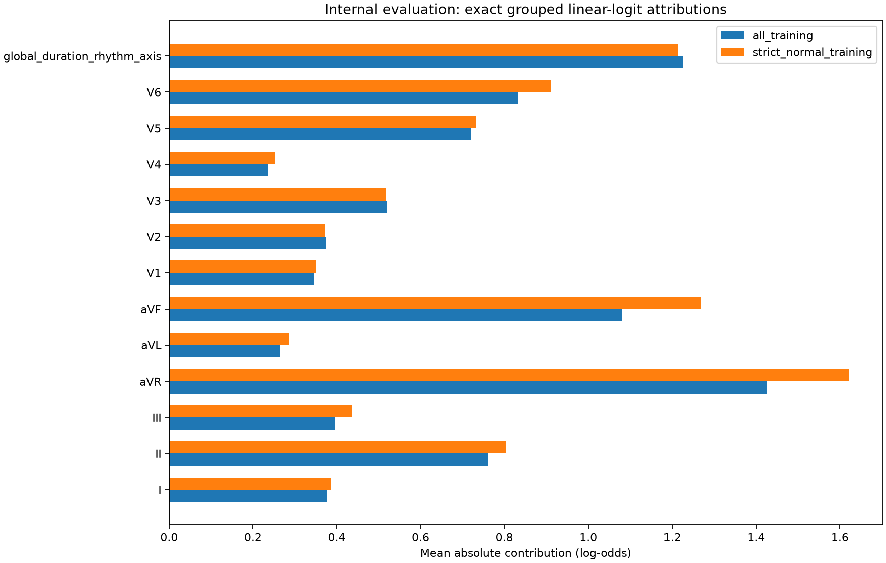

# SHAP-01 results: changing the reference population changes the leading explanation

18 October 2026. Changing only the explanation background changed the largest absolute lead/global
contribution for **175 of 400 patients (43.75%)**, while every model prediction stayed identical.
The largest positive group changed for **145 patients (36.25%)**. These are exact grouped explanations
of one fixed linear annotation-proxy model. They describe model dependence relative to a chosen
reference population; they do not validate clinical evidence or reveal the cause of disease.

The [prospective protocol](shap-01-linear-background-sensitivity.md) was committed locally as `7eb0fe1`,
and code/tests as `48f67e9` before the single fitted-model execution. The complete run took **2.95 seconds**
on CPU with two numerical threads. No waveform, GPU, new dependency, download, age/sex subgroup analysis,
push or PR was used. Model/scaler parameters, identities, predictions and full feature/group values
remain local under `outputs/shap01_linear_background/`.

## The fixed model and permitted denominator

Before any diagnostic payload parse or fit, the runner verified the frozen CLUSTER-01 result and
feature/identity/manifest bytes. It reproduced 17,418 ECGs / 15,023 patients in folds 1–8, the full
13,938 ECG / 12,078 patient PR67 training-role identity set, the predecessor's exact deterministic
2,000-patient sample and its one non-replaced exclusion. All 1,999 retained rows and 53 physical
features matched, with one ECG per patient and no nonfinite feature. Every record was rechecked as
PR67 train before diagnosis parsing. No PR67 validation, engineering-test, fold-9/10 patient or spent
clinical holdout entered the new model or either explanation background.

The existing diagnostic-superclass helper defined the unchanged annotation-proxy target: any abnormal
MI/STTC/CD/HYP superclass versus NORM alone, retaining existing treatment of code co-occurrence. The
existing strict project helper supplied only the strict-normal background definition; it was not a
new training target or clinical diagnosis.

| Executed selection | Patients |
| --- | ---: |
| Frozen physical-feature cohort | 1,999 |
| Defined / undefined superclass target | 1,965 / 34 |
| Internal model training | 1,565 |
| Training positive / negative | 877 / 688 |
| Internal evaluation | 400 |
| Evaluation positive / negative | 241 / 159 |
| All-training explanation background | 1,565 |
| Strict-normal training background | 546 |

The internal 80/20 assignment used the frozen patient hash. It creates patient-disjoint roles within
PR67 train, but the cohort and measurements were previously examined in CLUSTER-01. This remains an
exploratory internal evaluation, not a new independent clinical test.

One fresh StandardScaler and one balanced L2 logistic regression were fitted exclusively on the 1,565
internal training rows. No full-cohort PCA, residualizer or winsorizer was reused. The prespecified
C=1, lbfgs, tol=1e-8 fit converged in 185 iterations (maximum 2,000), with no feature/model selection.
The installed sklearn represents its legacy `penalty` default as `deprecated`; explicit `l1_ratio=0`
with C=1 and lbfgs implements L2, as recorded in `model_local.json`.

Secondary predictive context: evaluation AUROC was **0.8949**, whole-patient bootstrap 95% interval
**[0.8622, 0.9236]**, using 2,000 draws and seed 20261018, with zero skipped single-class draws. No
operating point was fitted or compared. These scores concern the existing annotation proxy; the
balanced model's probability outputs were not clinically calibrated or validated.

## What was explained exactly

For the fixed standardized-feature logit, each feature received
`phi_j = beta_j * (z_j - background_mean_j)` and the base was
`intercept + beta @ background_mean`. This is the exact linear interventional game described in the
[official SHAP documentation](https://shap.readthedocs.io/en/latest/generated/shap.LinearExplainer.html),
within the additive explanation framework of [Lundberg and Lee](https://arxiv.org/abs/1705.07874).
The implementation used direct algebra and no SHAP library or sampling approximation.

R/S/ST/T amplitude contributions were summed within each canonical lead; QRS duration, QT duration,
RR variation and axis sine/cosine formed a thirteenth global group. Every feature belonged once.
For this additive linear game, those sums also equal the exact group-coalition values. The explained
quantity is a logit, not probability; the base is mean background logit, not a calibrated disease risk
or the logit of mean background probability.

Both complete backgrounds came only from defined-label model-training patients. The strict-normal
subset required existing `project_label == 0`, rather than assuming every sinus-rhythm record is normal.
The same fitted coefficients, scaler and predictions were used under both backgrounds.

| Background sensitivity on the same 400 patients | Executed value |
| --- | ---: |
| Largest absolute group changed | 175 / 400 (43.75%) |
| Largest positive group changed | 145 / 400 (36.25%) |
| Mean top-three absolute-group overlap | 66.00% |
| Mean within-patient absolute-rank Spearman | 0.6957 |
| Signed group contribution changed sign | 742 / 5,200 (14.27%) |
| Patients with at least one sign change | 316 / 400 (79.00%) |
| Undefined rank correlations | 0 |
| Per-patient grouped L1 background shift | 4.1696 log-odds |

The all-training base was **+0.8284 log-odds**; the strict-normal base was **−1.6610**. For a fixed
linear model, the contribution difference between backgrounds is a constant per feature/group across
all patients. The total group shift here was +2.4894, exactly cancelling the −2.4894 base shift.
The grouped L1 shift ranged only from 4.169553619639299 to 4.169553619639302 due to roundoff. Rank and
sign changes happen because this shared offset interacts with each patient's existing contributions;
they are not new patient-specific waveform evidence.

| Lead/global group | Mean absolute, all-training | Mean absolute, strict-normal | Constant signed shift, normal minus all |
| --- | ---: | ---: | ---: |
| I | 0.376 | 0.386 | +0.153 |
| II | 0.761 | 0.804 | +0.174 |
| III | 0.395 | 0.438 | +0.139 |
| aVR | 1.427 | 1.621 | +1.188 |
| aVL | 0.265 | 0.287 | -0.074 |
| aVF | 1.080 | 1.268 | -0.599 |
| V1 | 0.345 | 0.350 | -0.060 |
| V2 | 0.374 | 0.371 | -0.017 |
| V3 | 0.519 | 0.516 | +0.139 |
| V4 | 0.237 | 0.253 | +0.089 |
| V5 | 0.720 | 0.731 | -0.091 |
| V6 | 0.832 | 0.911 | +0.650 |
| Global duration/rhythm/axis | 1.226 | 1.212 | +0.798 |

All values are log-odds contributions. Group aVR had the largest mean absolute attribution under both
backgrounds; the global group and aVF exchanged second and third place. This ranking identifies which
measured inputs this regularized proxy classifier uses relative to each background. It does not make
aVR or any other lead a verified disease site.



The prospectively fixed example was the lowest internal-evaluation patient ID, selected independently
of prediction or explanation. Its model logit was 1.527 under both games. The largest positive group
changed from V1 to the global duration/rhythm/axis group. Its signed bars and exact reconstructions are
in the locally inspected [PNG](../outputs/shap01_linear_background/fixed_example.png),
[SVG](../outputs/shap01_linear_background/fixed_example.svg) and local explanation table. The exemplar
and identifying tables remain local; the committed figure contains only aggregate group values.

## Numerical checks, provenance and interpretation

The maximum original feature/group additive or reconstruction error was **5.33e-15**, below the
frozen 1e-10 requirement. Group conservation, base cancellation, patient-independent background shifts
and top-five-positive-plus-remainder reconstructions all passed. Reconstructed probabilities agreed
within 5.56e-16, and the model's own probability array remained exactly identical across backgrounds.
Training scaler means matched exclusively training-row means with zero error, and its sample count
was exactly 1,565.

Independent reconstruction from saved coefficients/scaler and raw feature CSVs passed without any
refit: source/input/immutable-artifact hashes, internal split and train-only background membership,
scaler statistics, logits/probabilities, feature/group values, AUROC and sensitivity metrics.
The largest feature/group CSV reconstruction difference was 8.88e-16. The complete checks are in
[verification_local.json](../outputs/shap01_linear_background/verification_local.json).
The [completed result](../outputs/shap01_linear_background/result.json) SHA256 is
`d3d0e9e4ed488432d4ee5d1990622bfed6ad180120f9d3316905c4ac15414a05`.
The CLUSTER-01 result and feature-table hashes remain respectively
`74f0c82918f158a61368d308acdab5d5e98fe759852c966de76867e5c99bc8e7` and
`8d19be5e03e70c354191e5795109251702daab90f21c17dd384a95ac6261c28d`.
Mutable status was excluded from immutable-artifact hashing; the final status binds the completed result.

All 20 focused SHAP/predecessor tests passed, including exact coalition enumeration, merged-group
identity, an unused perfectly correlated feature, training-only fit/background contracts and explicit
no-positive-group behavior. Repository-wide Ruff passed. The complete CPU worktree suite produced
1,277 passed, six skipped and one existing symlink-related test failure in 68.85 seconds.
The frozen `test_graph_rejects_missing_and_conflicting_leaves` expects a missing-file error; the
required worktree `outputs` symlink is rejected first. Its sources/tests are unchanged from the branch
base, and the same test was verified earlier in this session to pass in the main checkout with a real
`outputs` directory. No frozen source, dependency or symlink was changed. There was one scored model
fit/run, with no post-score background, feature, model or threshold tuning.

This baseline passed its mathematical checks and demonstrated substantial background sensitivity.
It did not validate a clinical explanation. Leads and derived axis features are correlated; the
interventional game breaks those dependencies and can describe physiologically implausible feature
combinations. Conditional attribution, the full waveform model, temporal boundaries, replacement
faithfulness and expert pathological evidence remain untested. Neither high proxy AUROC nor exact
additivity changes those limits. Grouped feature SHAP must not be converted into a verified raw-time
pathology mask.

Reproduce into a fresh directory using the pinned local predecessor tables and existing environment:

```bash
PYTHONPATH="$PWD" UV_CACHE_DIR=/tmp/ecg-shap01-uv \
OMP_NUM_THREADS=2 OPENBLAS_NUM_THREADS=2 MKL_NUM_THREADS=2 \
MPLCONFIGDIR=/tmp/ecg-shap01-mpl CUDA_VISIBLE_DEVICES='' \
uv run --no-sync python -m scripts.reports.shap01 \
  --output outputs/shap01_linear_background_replay
```

Follow-up for the root-owned backlog: preserve this exact baseline and both backgrounds as controls;
only investigate conditional/group-aware replacements or waveform-model attribution under a new
prospective protocol with explicit correlated-feature and clinical-truth limitations. No follow-up
model or evaluation was run here.
